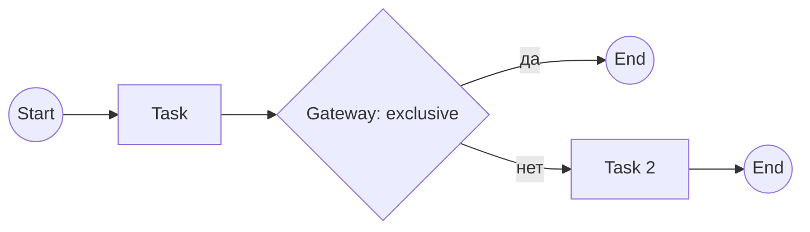
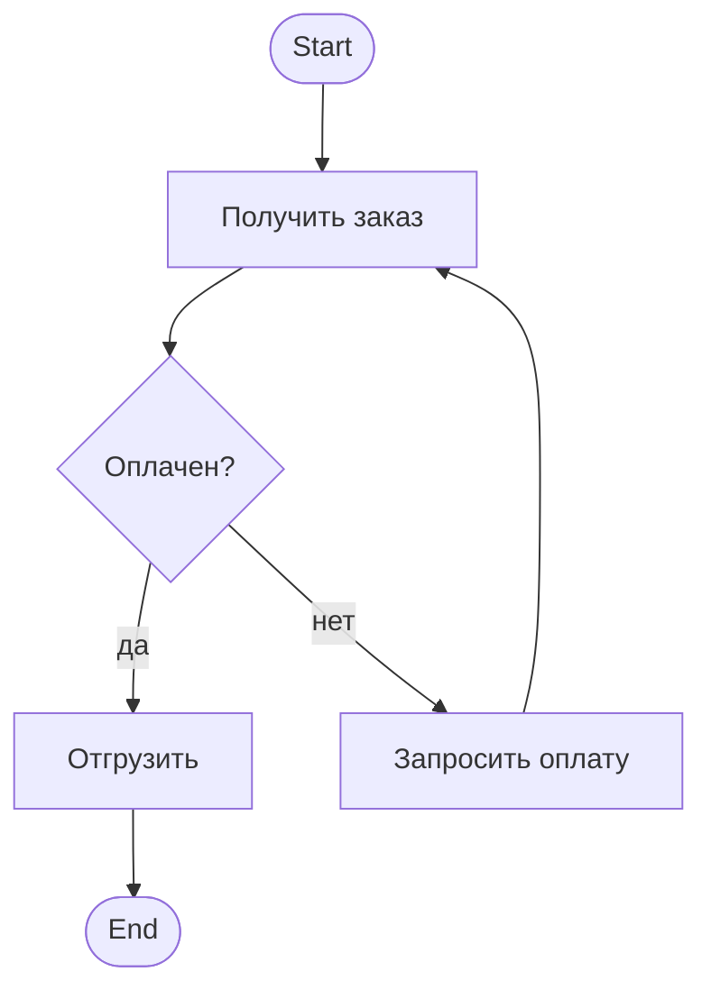
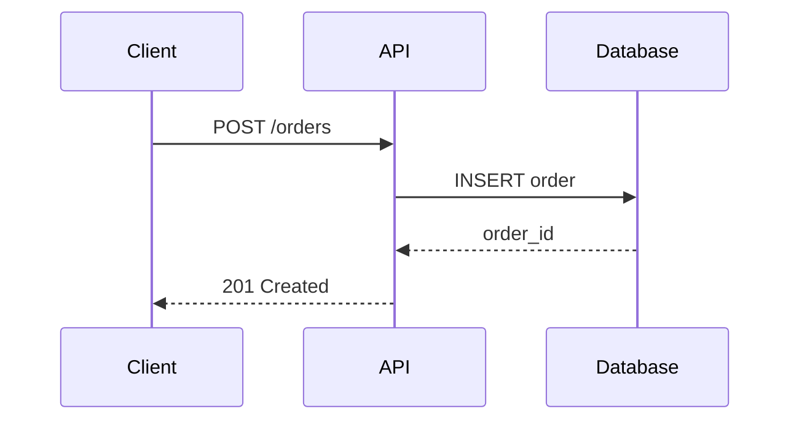
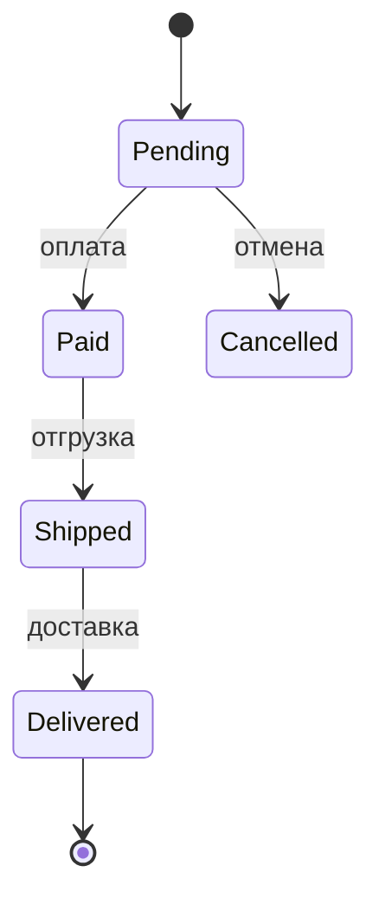
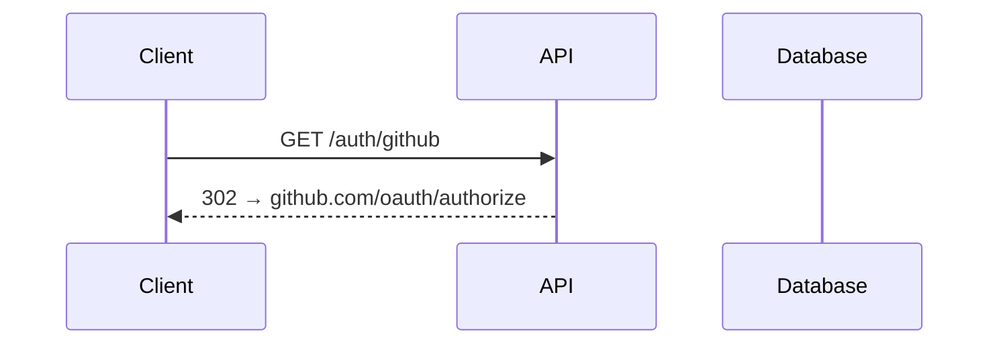
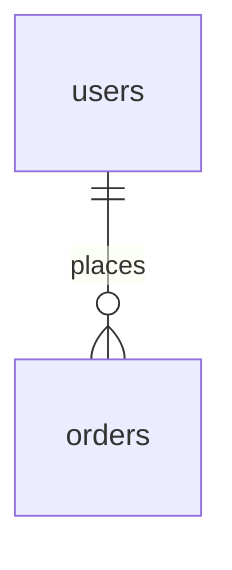

# Стандарты описания флоу

> [!info] Определение
> Стандарты и нотации описания потоков (flow): процессов, данных, взаимодействий
> и состояний. В SDD флоу фиксируются в [[План|плане]]/дизайне как Mermaid/PlantUML
> и служат основой для [[Задачи|задач]] и [[Контракты|контрактов]].
> См. [[Workflow SDD]], [[Главная]].

## 1. Главные стандарты

| Стандарт | Область | Что описывает |
|---|---|---|
| **BPMN 2.0.2** (OMG) | Бизнес-процессы | Полный жизненный цикл: события, активности, шлюзы, потоки, пулы/дорожки. Де-факто стандарт бизнес-флоу |
| **UML 2.5.1** (OMG) | ПО и системы | Activity (флоу действий), Sequence (взаимодействия), State Machine (состояния) |
| **ISO 5807:1985** | Блок-схемы | Символы и соглашения для схем данных, программ и систем |
| **ГОСТ 19.701-90** | Схемы алгоритмов | Российский аналог ISO 5807: схемы алгоритмов, программ, данных и систем |
| **EPC** (ARIS) | Бизнес-процессы | Event-driven Process Chains: «событие → функция → событие» |
| **DMN 1.4** (OMG) | Решения | Таблицы решений — флоу ветвлений в табличной форме |
| **CMMN** (OMG) | Кейсы | Case Management — процессы без жёсткого порядка |
| **Сети Петри** | Параллельные процессы | Формальная математическая модель параллелизма и синхронизации |
| **SysML** | Системная инженерия | Activity diagrams для систем (железо + софт) |
| **IEC 61131-3 (SFC)** | ПЛК/автоматика | Sequential Function Chart — шаги и переходы для контроллеров |
| **ArchiMate** | Корпоративная архитектура | Потоки между сервисами и компонентами предприятия |

## 2. Все варианты (типы) флоу

### 2.1. Процессные флоу

| Вариант | Суть |
|---|---|
| **Flowchart (блок-схема)** | Классика: процесс → решение → данные → начало/конец. Символы — [[ISO 5807]] / ГОСТ 19.701-90 |
| **BPMN** | События (start/intermediate/end), task, gateway (exclusive, parallel, inclusive, event-based), sequence/message flow, pools/lanes |
| **Swimlane (дорожки)** | Кто делает шаг: роли/отделы в отдельных «дорожках» |
| **EPC** | Чередование событий и функций, коннекторы И/ИЛИ |
| **VSM** | Value Stream Mapping (lean): material + information flow |
| **SIPOC** | Таблица верхнего уровня: Suppliers → Inputs → Process → Outputs → Customers |
| **ASME Process Chart** | Символы: операция, контроль, транспортировка, хранение, ожидание |

### 2.2. Потоки данных и управления

| Вариант | Суть |
|---|---|
| **DFD** | Data Flow Diagrams: потоки данных между процессами, хранилищами, внешними сущностями (нотации Yourdon/DeMarco, Gane-Sarson) |
| **Control Flow Graph** | Граф управления в компиляторах: basic blocks, ветвления |
| **Data Flow / Pipeline** | Потоки данных в ETL и стриминге |

### 2.3. Взаимодействия и состояния

| Вариант | Суть |
|---|---|
| **UML Sequence Diagram** | Порядок сообщений между объектами/участниками во времени |
| **UML State Machine** | Состояния и переходы по событиям (включая guards) |
| **Statecharts (Harel)** | Иерархические состояния, вложенность, параллельные регионы |
| **FSM (Mealy/Moore)** | Конечные автоматы в электронике и протоколах |
| **MSC** | Message Sequence Charts (ITU Z.120) — телекоммуникации |

### 2.4. Продуктовые/UX флоу

| Вариант | Суть |
|---|---|
| **User Flow** | Путь пользователя по экранам (Figma/Miro) |
| **API Flow** | Последовательность вызовов API (sequence diagram или OpenAPI + примеры) |
| **Screen Flow / Wireflow** | Экраны + переходы между ними |

### 2.5. Формальные модели

| Вариант | Суть |
|---|---|
| **Сети Петри** (и цветные CPN) | Параллелизм, дедлоки, достижимость |
| **YAWL / Workflow Patterns** | Паттерны control flow (Van der Aalst): sequence, choice, parallel, loop, discriminator |
| **BPMN + DMN + CMMN** | Трио OMG: процессы + решения + кейсы |

## 3. Символы классической блок-схемы (ISO 5807 / ГОСТ 19.701-90)

| Символ | Смысл |
|---|---|
| Овал (терминатор) | Начало / конец |
| Прямоугольник (процесс) | Действие, вычисление |
| Ромб (решение) | Проверка условия, ветвление |
| Параллелограмм (данные) | Ввод / вывод |
| Стрелки | Направление потока |
| Кружок/разрыв (соединитель) | Переход на другую страницу |
| Документ | Печатный вывод |
| Ручной ввод | Данные с клавиатуры |

## 4. BPMN: ключевые элементы



| Элемент | Типы |
|---|---|
| **Event** | Start, Intermediate (catch/throw), End; триггеры: message, timer, error, signal, conditional |
| **Activity** | Task (user, service, script, manual), Sub-Process, Call Activity |
| **Gateway** | Exclusive (XOR), Parallel (AND), Inclusive (OR), Event-based, Complex |
| **Flow** | Sequence flow (сплошная), Message flow (пунктир), Association |
| **Pool / Lane** | Участники (пулы) и роли внутри (дорожки) |

## 5. UML: три диаграммы флоу

### Activity Diagram



### Sequence Diagram



### State Machine



## 6. Примеры флоу в SDD-артефактах

### Флоу в [[План|плане]] (Mermaid)

```markdown
## Архитектура

```

### Флоу в [[Data Model|модели данных]] (ER)



### Флоу в [[Контракты|контрактах]] (API)

Последовательность вызовов описывается sequence diagram + примерами в OpenAPI
(см. [[Контракты]]).

## 7. Что выбрать когда

| Задача | Стандарт |
|---|---|
| Бизнес-процесс end-to-end | **BPMN 2.0.2** |
| Алгоритм / программа | **ISO 5807 / ГОСТ 19.701-90** или UML Activity |
| Взаимодействие объектов/сервисов | **UML Sequence** |
| Состояния объекта/протокола | **UML State Machine / Statecharts** |
| Потоки данных в системе | **DFD** |
| Решения и ветвления | **DMN** или BPMN gateway |
| Параллелизм, формальный анализ | **Сети Петри** |
| Путь пользователя в продукте | **User Flow** |
| Диаграммы в Markdown/Git | **Mermaid / PlantUML** (де-факто) |

## 8. Мнемоники

- **BPMN-элементы:** «События, Активности, Шлюзы, Потоки, Пулы» — **САШПП**.
- **UML-флоу:** «Активность, Последовательность, Состояния» — **АПС**.
- **Классическая блок-схема:** «Начало, Процесс, Решение, Данные, Стрелки» — **НПРДС**.

## 9. Связи

- [[План]] · [[Data Model]] · [[Контракты]] · [[Workflow SDD]] · [[Главная]]
- [[ГОСТ 19]] · [[ТЗ по ГОСТ 19]] · [[IEEE 830]] · [[Глоссарий]]

## 10. Типичные ошибки

> [!warning]
> Диаграмма картинкой (PNG) в репозитории: нельзя diff'ить и обновлять — используйте
> Mermaid/PlantUML как код. Диаграмма, которую нельзя обновить за 5 минут, устареет.
> Смешение нотаций в одном документе (BPMN + блок-схема) без пояснения.
