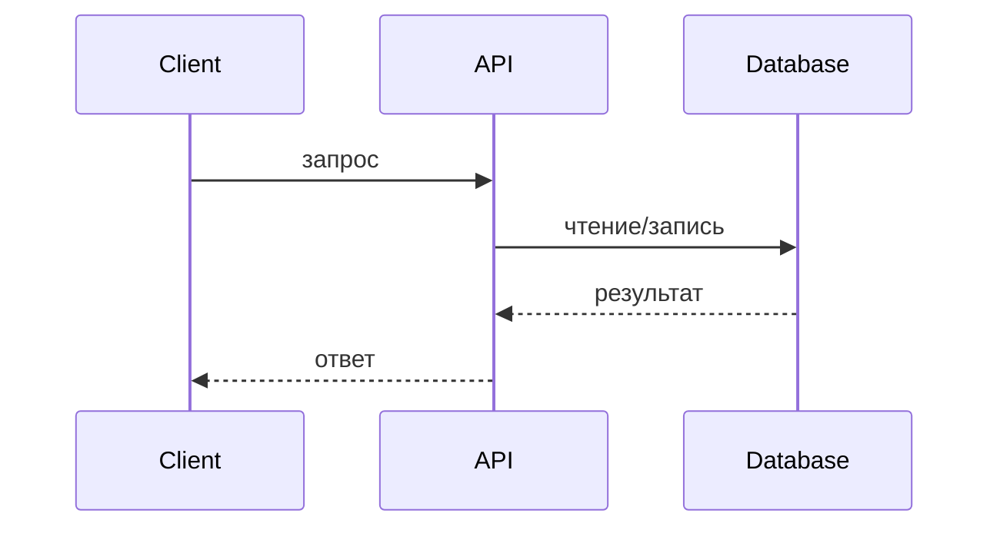

# Шаблоны артефактов SDD

Готовые шаблоны ключевых сущностей. Скопируйте в свой репозиторий и адаптируйте под команду.

## 1. spec.md (GitHub Spec Kit)

```markdown
# Спецификация: [Название фичи]

**Ветка**: `001-feature-name` | **Дата**: YYYY-MM-DD | **Статус**: Draft

## Обзор
[1–2 абзаца: что строим и зачем. Без деталей реализации.]

## Пользовательские истории

### US1 — [Название] (Приоритет: P1)
**Как** [роль], **я хочу** [цель], **чтобы** [польза].

**Критерии приёмки:**
1. Given [контекст], When [действие], Then [ожидаемый результат]
2. ...

### US2 — [Название] (Приоритет: P2)
...

## Функциональные требования

- **FR-001**: Система ДОЛЖНА [поведение] (EARS: WHEN [триггер], the [система] SHALL [ответ])
- **FR-002**: ...

## Нефункциональные требования

- **NFR-001**: [качество] — [измеримая цель] (например: отклик ≤ 200 мс при 1000 RPS)
- **NFR-002**: ...

## Критерии успеха

- [измеримый результат, не зависящий от реализации]

## Out of Scope

- [что явно НЕ входит]

## Открытые вопросы

- [ ] [вопрос] → ответ вносится на фазе clarify
```

## 2. plan.md (GitHub Spec Kit)

```markdown
# План реализации: [Название фичи]

**Спека**: `specs/001-feature-name/spec.md`
**Конституция**: `.specify/memory/constitution.md`

## Технический контекст

- **Язык/фреймворк**: ...
- **Зависимости**: ... (версии зафиксированы)
- **Хранение данных**: ...
- **Тестирование**: ...

## Архитектура

[Описание компонентов и потока запросов; Mermaid-диаграммы]



## Модель данных

[Ссылка на data-model.md или краткое описание сущностей]

## Контракты

[Ссылки на contracts/api-spec.json и др.]

## Ключевые решения

| Решение | Обоснование | Ссылка на конституцию |
|---|---|---|
| ... | ... | Статья N |

## Constitution Check

- [x] [принцип 1] — соблюдён: [как]
- [x] [принцип 2] — соблюдён: [как]
- [ ] [принцип 3] — НЕ соблюдён: [причина, план исправления]

## Порядок создания файлов

1. `src/models/...`
2. `src/services/...`
3. ...
```

## 3. tasks.md

```markdown
# Задачи: [Название фичи]

## Фаза 1: Настройка (Setup)

- [ ] T001 [P] Создать структуру каталогов `src/...`
- [ ] T002 Установить зависимости: `npm install ...`

## Фаза 2: Фундамент (Foundational)

- [ ] T003 [P] Создать модель `src/models/User.js` (FR-001)
- [ ] T004 [P] Создать миграцию БД `migrations/001_users.sql` (FR-001)

## Фаза 3: Пользовательская история 1 (US1)

- [ ] T005 [P] Реализовать сервис `src/services/AuthService.js` (FR-001, US1)
- [ ] T006 Создать эндпоинт `POST /api/auth/login` (FR-002, US1)
- [ ] T007 Написать тесты `tests/auth.test.js` (US1)

## Фаза 4: Полировка

- [ ] T008 Обновить документацию API
- [ ] T009 Проверить конституцию: все принципы соблюдены

**Легенда**: `[P]` — независимая задача, может выполняться параллельно.
Каждая задача трассируется к требованию (FR-XXX) или истории (USn).
```

## 4. constitution.md

```markdown
# Конституция проекта: [Название]

**Версия**: 1.0.0 | **Утверждена**: YYYY-MM-DD | **Утвердили**: [имена]

## Статья I. Качество кода

- Каждый модуль покрыт тестами; покрытие новых модулей ≥ 80%.
- Линт и typecheck обязательны в CI; merge без зелёного CI запрещён.

## Статья II. Безопасность

- Секреты никогда не коммитятся; только через secret manager.
- Все внешние вызовы имеют timeout и circuit breaker.
- Логи не содержат сырых промптов и персональных данных (только хэши и счётчики).

## Статья III. Архитектура

- Деньги хранятся в целых минимальных единицах (микро-доллары), не во float.
- Идемпотентные записи для всех операций записи.
- Append-only для финансовых журналов.

## Статья IV. API

- Публичные изменения API требуют bump версии.
- Контракты описываются в OpenAPI и версионируются в `contracts/`.

## Процесс изменений

Изменения в конституцию — только через PR с обоснованием, ревью мейнтейнерами
и увеличением версии. Аспирационные правила, которым никто не следует, запрещены:
конституция описывает только уже принятые и соблюдаемые принципы.
```

## 5. requirements.md в нотации EARS (Kiro)

```markdown
# Требования: [Название фичи]

## Введение
[Контекст и цель фичи.]

## Глоссарий
- **Термин**: определение

## Требования

### Требование 1: [Название]

**Пользовательская история:** Как [роль], я хочу [цель], чтобы [польза].

#### Критерии приёмки

1. WHEN [триггер], the [система] SHALL [ответ].
2. IF [нежелательное условие], THEN the [система] SHALL [ответ].
3. WHILE [состояние], the [система] SHALL [ответ].

### Требование 2: [Название]
...

## Нефункциональные требования

1. The [система] SHALL [измеримое качество] (Ubiquitous).
```

## 6. ADR — шаблон Nygard

```markdown
# ADR-NNNN: Краткий заголовок решения

- Status: Proposed | Accepted | Rejected | Deprecated | Superseded by ADR-XXXX
- Date: YYYY-MM-DD
- Deciders: [имена]
- Tags: database, auth, infra

## Context

Какую проблему мы видим? Какие силы действуют (технические, бизнес, социальные)?
Ограничения, цель, существующие альтернативы. 2–4 коротких абзаца.

## Decision

Что мы делаем, простым языком. Один абзац, в форме директивы:
«Мы будем использовать Postgres как основное хранилище данных.»

## Consequences

Что становится легче? Что сложнее? Какие новые риски?
Позитивные, негативные и нейтральные последствия — честно.
Если перечислены только плюсы, ADR сломан.

## Alternatives considered

Что ещё смотрели? Почему отклонили каждое? Одно предложение на альтернативу.

## Links

- Связанные ADR
- Spike-ветки, прототипы, бенчмарки
- Внешние ссылки (документация вендора, RFC, статьи)
```

## 7. ADR — шаблон MADR (расширенный)

```markdown
# [Номер]. [Заголовок]

* Status: accepted
* Date: YYYY-MM-DD
* Decision Makers: [имена]

## Context and Problem Statement

[Контекст, проблема, драйверы решения.]

## Decision Drivers

* [драйвер 1: стоимость, производительность, команда…]
* [драйвер 2]

## Considered Options

* [Опция A]
* [Опция B]
* [Опция C]

## Decision Outcome

Chosen option: [A], because [обоснование].

### Pros and Cons of the Options

#### [Опция A]

* Good, because [плюс]
* Bad, because [минус]

#### [Опция B]
...

## Links

- [ссылки]
```

## 8. proposal.md (OpenSpec)

```markdown
# Proposal: [Название изменения]

## Intent
[Зачем существует изменение.]

## Scope
- [что входит]
- [что входит]

## Out of Scope
- [что не входит]

## Approach
[Технический подход в общих чертах.]

## Impact
- [затронутые домены/сервисы]
- [миграции, совместимость]
```

## 9. Delta spec (OpenSpec)

```markdown
# Delta for [Domain]

## ADDED Requirements

### Requirement: Two-Factor Authentication
The system MUST require a second factor during login.

#### Scenario: OTP required
- GIVEN a user with 2FA enabled
- WHEN the user submits valid credentials
- THEN an OTP challenge is presented

## MODIFIED Requirements

### Requirement: Session Timeout
The system SHALL expire sessions after 30 minutes of inactivity.
(Previously: 60 minutes)

#### Scenario: Idle timeout
- GIVEN an authenticated session
- WHEN 30 minutes pass without activity
- THEN the session is invalidated

## REMOVED Requirements

### Requirement: Remember Me
(Deprecated in favor of 2FA)
```

## 10. SRS по IEEE 830 (сокращённый каркас)

```markdown
# SRS: [Название системы]

## 1. Introduction
### 1.1 Purpose
### 1.2 Scope
### 1.3 Definitions, acronyms and abbreviations
### 1.4 References
### 1.5 Overview

## 2. Overall Description
### 2.1 Product perspective
### 2.2 Product functions
### 2.3 User characteristics
### 2.4 Constraints
### 2.5 Assumptions and dependencies

## 3. Specific Requirements
### 3.1 External Interface Requirements
### 3.2 Functional Requirements
- SRS-1: The system shall [поведение]. (Verification: Test)
### 3.3 Performance Requirements
### 3.4 Design Constraints
### 3.5 Software System Attributes
### 3.6 Other Requirements

## 4. Appendices
### 4.1 Glossary
### 4.2 Traceability matrix
### 4.3 Revision history
```

## 11. PRD (краткий шаблон)

```markdown
# PRD: [Название продукта/фичи]

## Проблема
[Кому и как больно сейчас.]

## Пользователи
[Персоны, сегменты.]

## Цели и метрики успеха
- [метрика]: [текущее] → [целевое]

## Scope
### Входит
### Не входит

## Пользовательские истории
[ссылки на spec.md / требования]

## Риски и допущения
```

## 12. RFC / Design Doc (краткий шаблон)

```markdown
# RFC: [Название]

- Author: ...
- Status: Draft | In Review | Accepted
- Date: ...

## Context
[Проблема, контекст, ограничения.]

## Proposal / Design
[Предлагаемый дизайн.]

## Alternatives Considered
[Альтернативы и почему отклонены.]

## Rollout Plan
[Как внедряем: флаги, этапы, откат.]

## Open Questions
```

---

## Источники

- GitHub Spec Kit — templates (spec-template.md, plan-template.md, tasks-template.md, constitution-template.md, checklist-template.md)
- Kiro — документация specs
- OpenSpec — docs/writing-specs.md, getting-started.md
- ADR: шаблон Nygard (2011), MADR (adr.github.io/madr)
- IEEE 830-1998 — структура SRS
- Google Design Docs / RFC-процесс
