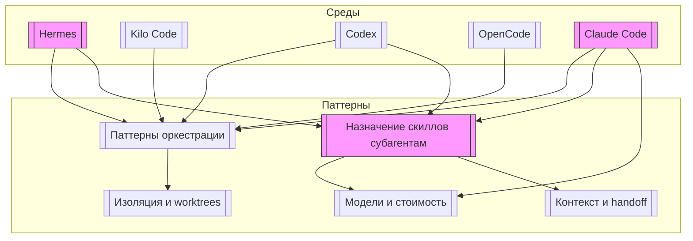

# 🏠 Энциклопедия субагентов и сложных агентных систем

Самодостаточное хранилище (Obsidian vault) о лучших практиках использования
субагентов и построения сложных систем в современных агентных средах:
**Hermes, Kilo Code, Codex, OpenCode, Claude Code**.
Навигация — через `[[wikilink]]`, теги `#среда`, `#паттерн`, `#пример`.

> [!tip] Как читать
> Начните с [[Hermes]] (самая развитая иерархия скиллов) и [[Паттерны оркестрации]]
> (общие паттерны). Каждая среда — отдельный документ в папке `Среды/`.
> Ключевой вопрос «как назначать скиллы субагентам» — [[Назначение скиллов субагентам]].

## Карта экосистемы

## Мнемоника экосистемы

**«Оркестратор планирует, Субагенты исполняют, Скиллы специализируют»** — **ОСС**.

| Слой | Роль | Где живёт |
|---|---|---|
| Оркестратор | Планирование, декомпозиция, синтез | Главный агент среды |
| Субагенты | Параллельное исполнение подзадач | [[Паттерны оркестрации]] |
| Скиллы | Специализация каждого субагента | [[Назначение скиллов субагентам]] |

## Разделы энциклопедии

### Среды (отдельный документ на каждую)
- [[Hermes]] · [[Kilo Code]] · [[Codex]] · [[OpenCode]] · [[Claude Code]]

### Паттерны
- [[Паттерны оркестрации]] · [[Назначение скиллов субагентам]] · [[Модели и стоимость]]
- [[Изоляция и worktrees]] · [[Контекст и handoff]]

### Примеры
- [[Пример оркестратора]] · [[Чек-листы]]

### Справочник
- [[Справочник сред]] · [[Глоссарий]]

## Ключевые факты (2026)

- **Hermes** (Nous Research): иерархия config → SOUL.md → AGENTS.md → профили → скиллы;
  скиллы — процедурная память, которую агент создаёт сам; delegate_task с live-управлением.
- **Kilo Code**: orchestrator mode deprecated — агенты с полным доступом делегируют нативно;
  Agent Manager + git worktrees; Kilo Swarm (общая доска находок).
- **Codex**: три слоя — Skill (.agents/skills/), AGENTS.md (иерархический), Agent (TOML);
  встроенные default/worker/explorer.
- **OpenCode**: primary vs subagent режимы; конфиг в opencode.json или .opencode/agents/*.md.
- **Claude Code**: субагенты через Task tool, Agent Teams, Dynamic Workflows;
  оркестратор Opus + субагенты Haiku = экономия 5–10×.
- **Общий принцип**: узкие ответственности субагентов бьют general-purpose; качество
  оркестратора определяет качество всей системы.

## Принципы этого хранилища

1. Одна среда/паттерн — одна страница (атомарность).
2. Каждая страница: определение, формат, содержание, пример, диаграмма, мнемоника, связи.
3. Связи — `[[wikilink]]`; обратные ссылки Obsidian строит автоматически.
4. Теги: `#среда`, `#паттерн`, `#пример`, `#субагенты`.
5. Диаграммы — Mermaid.

---
*Энциклопедия собрана из исследования субагентов в Hermes, Kilo Code, Codex, OpenCode и Claude Code (ноябрь 2026).*
