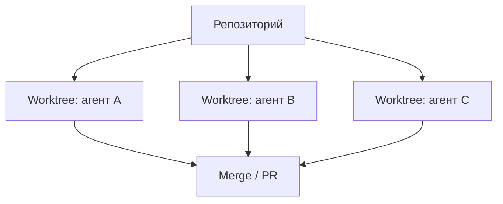

# Изоляция и worktrees

> [!info] Определение
> Уровни изоляции параллельных агентов: контекст, файлы, память, доступ.
> Параллелизм без изоляции = конфликты и загрязнение контекста.
> См. [[Паттерны оркестрации]], [[Hermes]], [[Kilo Code]].

## Уровни изоляции

| Уровень | Что изолируется | Механизм |
|---|---|---|
| Контекст | История диалога | Fresh context субагента (все среды) |
| Файлы | Рабочая копия репозитория | Git worktrees (Kilo, Codex, Claude Code) |
| Память | Долговременная память | Профили Hermes (isolated memory) |
| Доступ | Инструменты и права | Least privilege per agent |
| Сессии | Полная изоляция | Agent Teams (Claude Code), tmux (Codex) |

## Git worktrees: паттерн

- Каждый агент — в своей копии репозитория (поддиректория).
- Агент A добавляет API endpoint; агент B рефакторит auth; агент C пишет тесты.
- По завершении: merge, apply changes, commit или PR.
- Read-heavy workflow: параллельные агенты в одном worktree (один пишет, второй ревьюит).

## Профили Hermes: изоляция по умолчанию

- Каждый профиль: своя память, модель, провайдер, инструменты, скиллы.
- Kanban dispatcher спавнит агента в чистом workspace.
- Рекомендация сообщества: 15–20 скиллов на профиль; память изолировать важнее рантайма.

## Диаграмма

## Мнемоника

**«Контекст, Файлы, Память, Доступ»** — КФПД.

## Связи

- [[Паттерны оркестрации]] · [[Hermes]] · [[Kilo Code]] · [[Codex]] · [[Назначение скиллов субагентам]]

## Типичные ошибки

> [!warning]
> Параллельные write-агенты в одном worktree: конфликты. Общая память у всех профилей:
> загрязнение контекста. Субагент с полными правами: нарушение least privilege.
