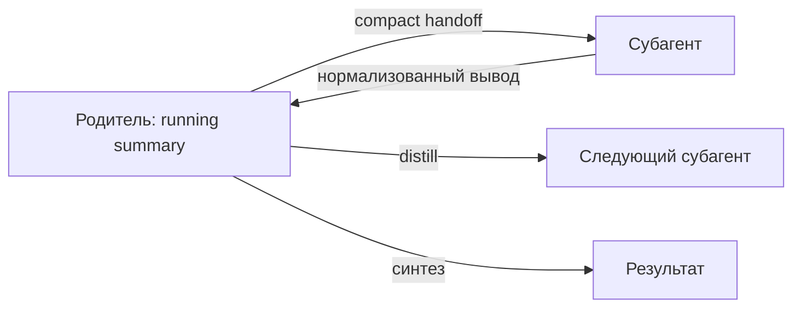

# Контекст и handoff

> [!info] Определение
> Как передавать контекст между субагентами: компактный handoff, нормализация
> вывода, fallback-цепочки, синтез у родителя. См. [[Паттерны оркестрации]],
> [[Назначение скиллов субагентам]].

## Правила передачи контекста

1. **Compact handoff**: родитель держит running summary; субагенту — только релевантное,
   а не полная история.
2. **Output Normalization**: единый формат вывода субагентов — родитель парсит без угадывания.
3. **Selective sharing**: воркеру — только task-relevant subset контекста.
4. **Synthesis at parent**: интеграция и синтез — только у оркестратора.

## Fallback-цепочки

```
Primary: code-review subagent
On failure: reduce scope to a single function, retry
On second failure: surface to user with context
```

| Сбой | Реакция |
|---|---|
| Неоднозначная задача | Уточнить инструкции и повторить |
| Слишком большой scope | Разбить на меньшие подзадачи |
| Отсутствует env/auth | Эскалация человеку (заранее определено) |

## Пример: handoff-контракт

```markdown
## Task envelope
- Objective: <одна строка>
- Inputs: <файлы/контекст>
- Output format: <структура>
- Acceptance criteria: <проверяемо>
- Scope: <границы файлов>
```

## Диаграмма



## Мнемоника

**«Контекст, Формат, Ошибки, Синтез»** — КФОС.

## Связи

- [[Паттерны оркестрации]] · [[Назначение скиллов субагентам]] · [[Модели и стоимость]] · [[Claude Code]] · [[Hermes]]

## Типичные ошибки

> [!warning]
> Полная история субагенту: трата токенов и шум. Субагенты интегрируют сами себя:
> дубли и конфликты. Нет fallback-цепочки: один сбой валит всю систему.
