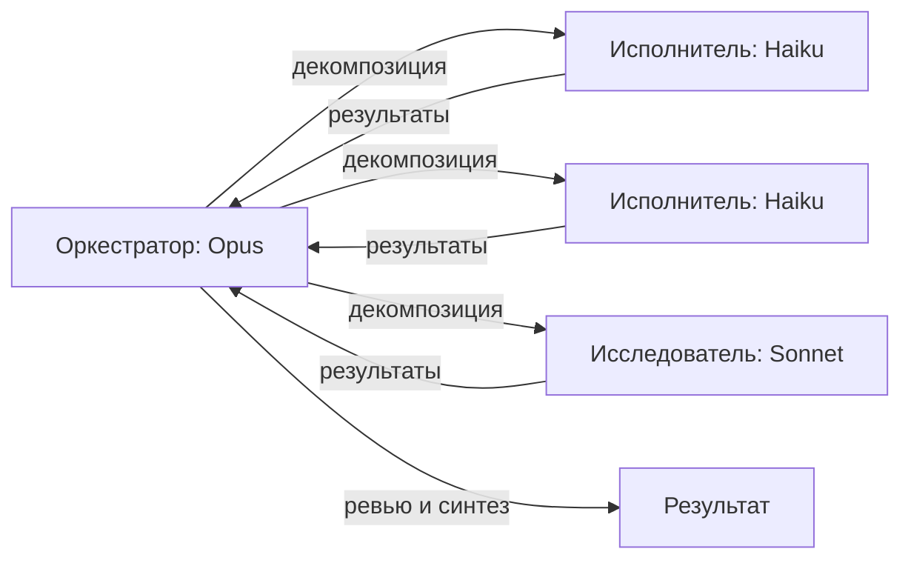

# Модели и стоимость

> [!info] Определение
> Роутинг моделей по ролям: дорогой reasoning-оркестратор + дешёвые исполнители.
> Экономия 5–10× без потери качества. См. [[Назначение скиллов субагентам]],
> [[Паттерны оркестрации]].

## Принцип: дорогой мозг, дешёвые руки

| Роль | Модель | Почему |
|---|---|---|
| Оркестратор | Frontier (Opus, kimi-k2.6) | Планирование, декомпозиция, синтез, ревью |
| Исполнители | Быстрая/дешёвая (Haiku, glm-5.1) | Инструменты, следование инструкциям, структура |
| Исследователи | Средняя | Поиск, чтение, классификация |

> Правило: «если задача ясна junior-разработчику — субагент справится;
> если нужно суждение — остаётся у оркестратора».

## Конфигурация по средам

| Среда | Как задаётся |
|---|---|
| Hermes | delegation.model + provider в config.yaml |
| Kilo Code | subagent_model в kilo.jsonc |
| Claude Code | model в Task-вызове / frontmatter агента |
| OpenCode | model per agent в opencode.json |
| Codex | model в TOML-агенте |

## Правила роутинга

1. **По сложности задачи**, а не только по типу: быстрый read — Haiku; сложный алгоритм — Sonnet.
2. **Контекст оркестратора** — бюджет на синтез выходов субагентов; выходы — concise.
3. **Fast tier не для контента**: заметная потеря качества на генерации текста.
4. **Temperature per role**: 0.1–0.3 для кода/ревью; выше — для креатива/исследования.

## Диаграмма

## Мнемоника

**«Дорогой мозг, Дешёвые руки»** — ДМДР.

## Связи

- [[Назначение скиллов субагентам]] · [[Паттерны оркестрации]] · [[Hermes]] · [[Claude Code]] · [[Контекст и handoff]]

## Типичные ошибки

> [!warning]
> Одна модель на всё: переплата за исполнение. Слишком широкий контекст субагенту:
> трата токенов на обоих уровнях. Фиксированная модель без учёта сложности задачи.
