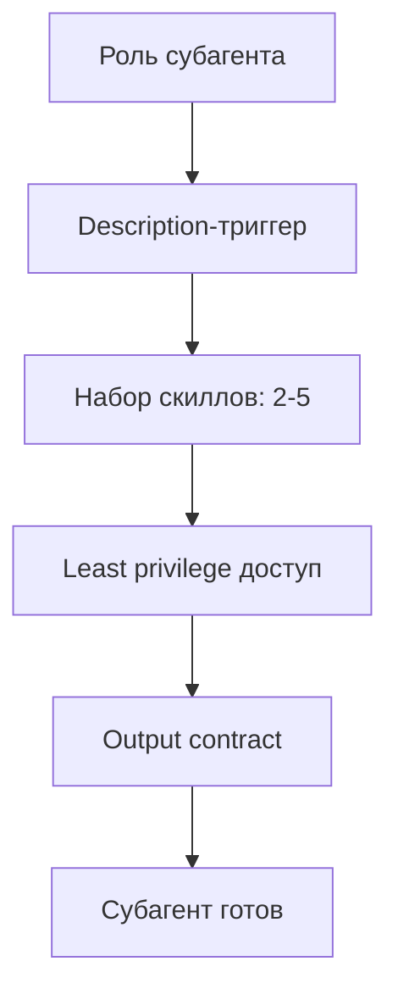

# Назначение скиллов субагентам

> [!info] Определение
> Как привязать скиллы к субагентам: роль → триггер → набор скиллов → доступ →
> проверка. Субагент стартует не с пустым контекстом, а с готовым набором экспертиз.
> См. [[Hermes]], [[Claude Code]], [[Codex]], [[OpenCode]].

## Пять шагов назначения

| Шаг | Вопрос | Результат |
|---|---|---|
| 1. Роль | Одна чёткая ответственность? | Узкий scope субагента |
| 2. Триггер | Когда его вызывать? | Description с ключевыми терминами |
| 3. Набор | Какие скиллы нужны? | 2–5 релевантных скиллов, не все |
| 4. Доступ | Какие инструменты? | Least privilege: read-only без Edit/Write |
| 5. Проверка | Как верифицировать? | Output contract + evidence |

## Как это делается в каждой среде

| Среда | Механизм |
|---|---|
| **Claude Code** | Поле `skills:` во frontmatter агента (.claude/agents/*.md) |
| **Hermes** | Профиль агента: модель + память + инструменты + набор скиллов; Skill Bundles |
| **Codex** | TOML-агент (.codex/agents/) + AGENTS.md на директорию агента + .agents/skills/ |
| **OpenCode** | tools/permissions в конфиге агента; скиллы в .opencode/skills/ |
| **Kilo Code** | agents.json (bundle) + .kilo/skills/ + subagent_model |

## Пример: Claude Code

```yaml
---
name: api-implementer
description: Implement or update API endpoints using existing patterns.
  Use after requirements and contracts are clear.
tools: Read, Grep, Glob, Edit, Write, Bash
model: sonnet
skills:
  - api-conventions
  - error-handling-patterns
maxTurns: 36
---
```

## Пример: Hermes (профиль)

```yaml
profile: security-reviewer
model: glm-5.1:cloud
skills:
  - security-audit
  - owasp-checklist
tools: [read_file, grep, web_search]   # без записи
memory: isolated
```

## Правила набора скиллов

1. **2–5 скиллов на субагента**, не весь каталог (шум в контексте).
2. **Скилл = экспертиза роли**: frontend-design → frontend-субагент; tdd → QA-субагент.
3. **Read-only субагентам** — только read-скиллы, без Edit/Write.
4. **Оркестратору** — скиллы планирования/синтеза, а не исполнения.
5. **Проверка набора**: триггер-тесты (5 «должны» + 5 «не должны»).

## Диаграмма



## Мнемоника

**«Роль, Триггер, Набор, Доступ, Проверка»** — РТНДП.

## Связи

- [[Hermes]] · [[Claude Code]] · [[Codex]] · [[OpenCode]] · [[Kilo Code]] · [[Паттерны оркестрации]] · [[Модели и стоимость]]

## Типичные ошибки

> [!warning]
> Все скиллы всем субагентам: шум и ложные триггеры. Субагент без триггера в description:
> не вызывается. Read-only роль с правами записи: нарушение безопасности.
