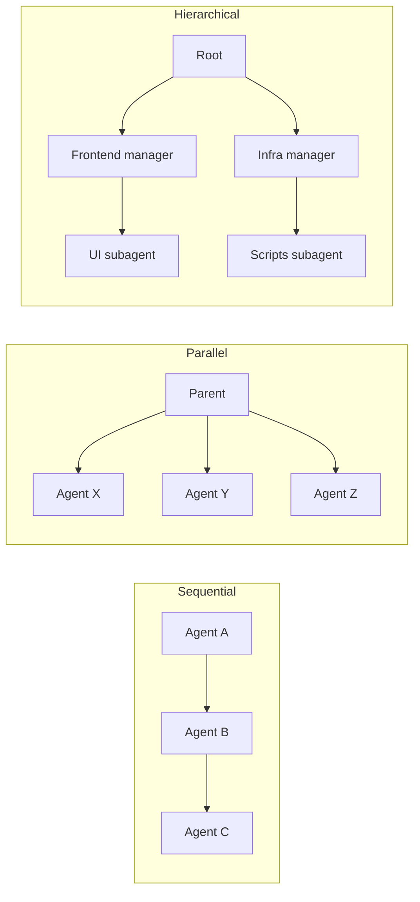

# Паттерны оркестрации

> [!info] Определение
> Способы координации субагентов в сложных системах: sequential, parallel,
> hierarchical, hub-and-spoke, pipeline, consensus. Выбор паттерна — по структуре
> задачи, а не по привычке. См. [[Hermes]], [[Claude Code]], [[Назначение скиллов субагентам]].

## Каталог паттернов

| Паттерн | Структура | Когда |
|---|---|---|
| Sequential | A → B → C, каждый ждёт предыдущего | Зависимости между шагами |
| Parallel | A, B, C одновременно | Независимые подзадачи |
| Hierarchical | Менеджеры владеют подсистемами | Большие проекты, когнитивная нагрузка |
| Hub-and-Spoke | Оркестратор в центре, специалисты по краям | Специализация + синтез |
| Pipeline | Architect → Developer → QA → DevOps | Контент/софтвер production |
| Consensus | Planner → Architect → Critic до согласия | Качество плана критично |
| Skill Chain | Фазы — отдельные скиллы | Фазы полезны независимо |
| Hybrid | Цепочка + субагенты внутри фазы | Смешанная структура |

## Диаграммы паттернов

## Правила выбора

1. **Зависимости?** Да → sequential/pipeline. Нет → parallel.
2. **Масштаб?** Большой → hierarchical (менеджеры снижают нагрузку на родителя).
3. **Качество плана?** Критично → consensus (Planner/Architect/Critic).
4. **Фазы переиспользуемы?** Да → skill chain.
5. **Смешанная структура?** → hybrid.

## Пример: notification system (Claude Code)

1. Parent планирует работу.
2. frontend-design субагент — NotificationBell UI.
3. Backend субагент — WebSocket инфраструктура и схема.
4. tdd субагент — сценарии тестов.
5. webapp-testing субагент — валидация в браузере.
6. Parent ревьюит выходы, разрешает конфликты, собирает PR.

## Мнемоника

**«Последовательно, Параллельно, Иерархически, Консенсус»** — ППИП.

## Связи

- [[Hermes]] · [[Claude Code]] · [[Kilo Code]] · [[Назначение скиллов субагентам]] · [[Изоляция и worktrees]] · [[Контекст и handoff]]

## Типичные ошибки

> [!warning]
> Параллелизм там, где есть зависимости: интеграционные проблемы. Субагенты интегрируют
> сами себя: дубли и конфликты. Слишком глубокая иерархия: сложность отладки.
