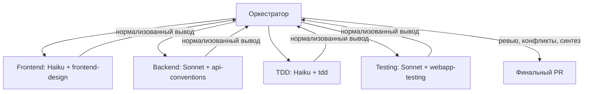

# Пример: оркестратор + субагенты (Hermes + Claude Code)

> [!info] Определение
> Сквозной пример сложной системы: оркестратор планирует, субагенты исполняют
> со своими скиллами, синтез у родителя. См. [[Паттерны оркестрации]],
> [[Назначение скиллов субагентам]].

## Сценарий: фича «уведомления»

```
Оркестратор (Opus / kimi-k2.6)
├── frontend subagent (Haiku) + скилл frontend-design
├── backend subagent (Sonnet) + скиллы api-conventions, error-handling
├── tdd subagent (Haiku) + скилл tdd
└── webapp-testing subagent (Sonnet) + скилл webapp-testing
```

## Шаги

1. **Parent** получает запрос, планирует работу, строит dependency map.
2. **frontend-design** субагент — NotificationBell UI component.
3. **Backend** субагент — WebSocket инфраструктура и схема уведомлений.
4. **tdd** субагент — сценарии тестов (delivery, ordering, read-state).
5. **webapp-testing** субагент — валидация в браузере.
6. **Parent** ревьюит выходы, разрешает конфликты, собирает PR.

## Конфигурация Hermes (delegation)

```yaml
delegation:
  model: 'glm-5.1:cloud'          # дешёвые исполнители
  max_concurrent_children: 4
  max_spawn_depth: 1
  child_timeout_seconds: 600
```

## Конфигурация Claude Code (субагент)

```yaml
---
name: frontend-builder
description: Builds UI components from approved designs. Use after design is clear.
tools: Read, Grep, Glob, Edit, Write
model: haiku
skills:
  - frontend-design
maxTurns: 24
---
```

## Диаграмма



## Мнемоника

**«План, Параллель, Синтез»** — ППС.

## Связи

- [[Паттерны оркестрации]] · [[Назначение скиллов субагентам]] · [[Модели и стоимость]] · [[Контекст и handoff]] · [[Hermes]] · [[Claude Code]]

## Типичные ошибки

> [!warning]
> Субагенты без dependency map: интеграционные проблемы. Выходы без нормализации:
> родитель угадывает формат. Нет fallback: один сбой валит фичу.
