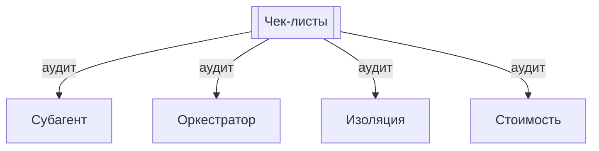

# Чек-листы: аудит системы субагентов

> [!info] Определение
> Контрольные списки качества: назначение скиллов, оркестрация, изоляция, стоимость.
> См. [[Назначение скиллов субагентам]], [[Паттерны оркестрации]].

## Чек-лист субагента

- [ ] Одна чёткая ответственность (узкий scope)
- [ ] Description-триггер с ключевыми терминами
- [ ] 2–5 релевантных скиллов, не весь каталог
- [ ] Least privilege: read-only без Edit/Write
- [ ] Модель по сложности задачи (не одна на всех)
- [ ] maxTurns / timeout / max_iterations заданы
- [ ] Output contract: единый формат вывода
- [ ] Acceptance criteria проверяемы

## Чек-лист оркестратора

- [ ] Dependency map перед диспетчем
- [ ] Sequential только где есть зависимости
- [ ] Running summary в родителе (не полная история субагентам)
- [ ] Fallback-цепочки: retry → reduce scope → escalate
- [ ] Синтез и интеграция только у родителя
- [ ] Мониторинг токенов; сброс завершённых контекстов

## Чек-лист изоляции

- [ ] Fresh context у субагентов
- [ ] Git worktrees для write-heavy параллелизма
- [ ] Память изолирована per profile (Hermes)
- [ ] Доступ к инструментам per agent
- [ ] Глубина рекурсии ограничена (max_spawn_depth)

## Чек-лист стоимости

- [ ] Дорогой оркестратор + дешёвые исполнители
- [ ] Роутинг по сложности, а не только по типу
- [ ] Выходы субагентов concise (бюджет синтеза)
- [ ] Fast tier не для контента

## Диаграмма

## Мнемоника

**«Роль, Оркестрация, Изоляция, Стоимость»** — РОИС.

## Связи

- [[Назначение скиллов субагентам]] · [[Паттерны оркестрации]] · [[Изоляция и worktrees]] · [[Модели и стоимость]] · [[Пример оркестратора]]
