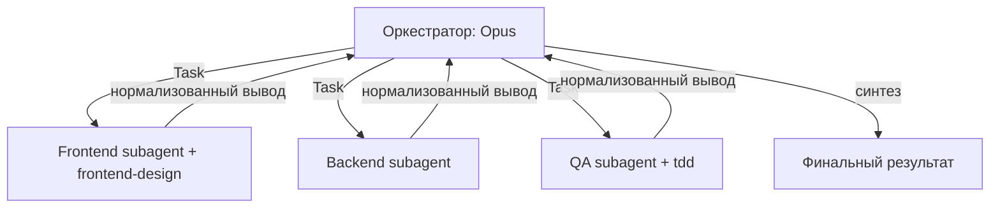

# Claude Code

> [!info] Определение
> Агентная среда Anthropic (CLI + IDE). Субагенты через Task/Agent tool, Agent Teams
> (коммуницирующие сессии), Dynamic Workflows (скриптовая оркестрация). Самая зрелая
> экосистема скиллов. См. [[Назначение скиллов субагентам]], [[Паттерны оркестрации]].

## Субагенты

- **Запуск**: Task tool из сессии; fresh context (не наследует историю) или fork
  (наследует текущую беседу).
- **Кастомные агенты**: `.claude/agents/*.md` с frontmatter:

```yaml
---
name: api-implementer
description: Implement or update API endpoints... Use after requirements are clear.
tools: Read, Grep, Glob, Edit, Write, Bash
model: sonnet
skills:
  - api-conventions
  - error-handling-patterns
maxTurns: 36
---
```

- **Agent Teams**: независимые сессии, коммуницирующие друг с другом (не родитель-ребёнок).
- **Dynamic Workflows**: скрипт оркестрирует многих субагентов на большом масштабе.

## Назначение скиллов субагентам

Поле `skills:` во frontmatter агента — скиллы предзагружаются в субагента.
Субагент стартует с готовым набором экспертиз, а не с пустым контекстом.

## Паттерны координации

| Паттерн | Когда |
|---|---|
| Sequential | Каждый шаг зависит от предыдущего |
| Parallel | Независимые подзадачи (frontend + backend + QA) |
| Hierarchical | Менеджеры владеют подсистемами (src/components/, deployment/) |
| Sub-agent pattern | Параллельные перспективы на одну задачу (grader, comparator) |
| Skill chain | Фазы research → execution → report, каждая — свой скилл |
| Hybrid | Цепочка фаз + субагенты внутри фазы |

## Техники композиции

- **Output Normalization**: единый формат вывода субагентов — родитель парсит без угадывания.
- **Fallback Chains**: primary → reduce scope → escalate to user.
- **Context Passing**: родитель держит running summary; субагенту — компактный handoff,
  а не полная история.

## Модели и стоимость

- Оркестратор Opus + субагенты Haiku/DeepSeek: экономия 5–10× без потери качества.
- Правило: «если задача ясна junior-разработчику — субагент справится; если нужно
  суждение — остаётся у оркестратора».

## Диаграмма



## Мнемоника

**«Узкие роли, Нормализация вывода, Fallback-цепочки, Компактный handoff»** — УНФК.

## Связи

- [[Hermes]] · [[Назначение скиллов субагентам]] · [[Паттерны оркестрации]] · [[Модели и стоимость]] · [[Контекст и handoff]] · [[Справочник сред]]

## Типичные ошибки

> [!warning]
> Субагенты интегрируют сами себя: дубли и конфликты — интеграция только у родителя.
> Слишком широкий контекст субагенту: трата токенов на обоих уровнях. Read-only агент
> с Edit/Write: нарушение least privilege.
