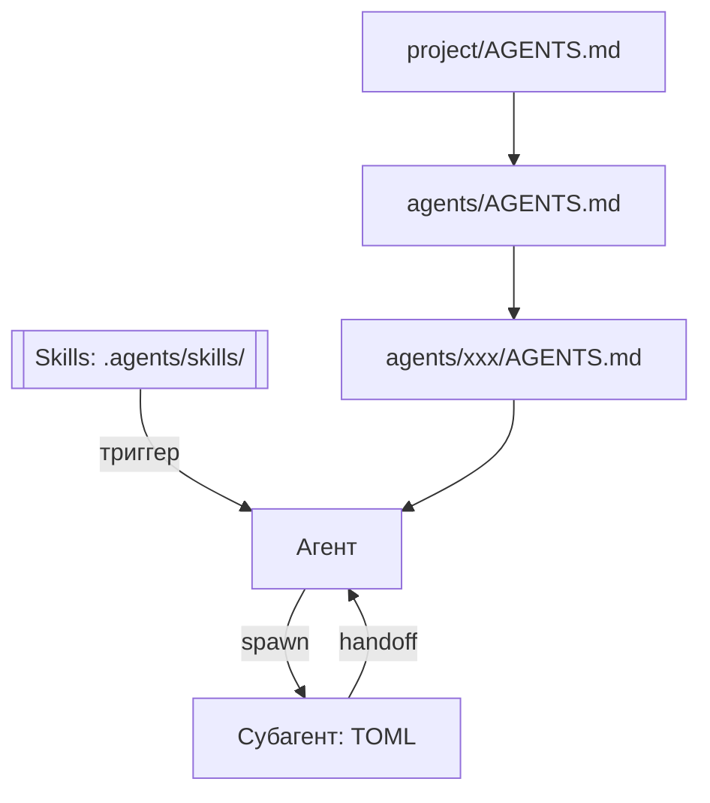

# Codex (OpenAI)

> [!info] Определение
> Агентная среда OpenAI (CLI + IDE + app). Три слоя: Skill, AGENTS.md, Agent.
> Субагенты — встроенные default/worker/explorer + кастомные TOML-агенты.
> См. [[Назначение скиллов субагентам]], [[Паттерны оркестрации]].

## Три слоя

| Слой | Что | Где живёт |
|---|---|---|
| Skill | Переиспользуемое поведение, workflow, конвенции | `.agents/skills/` или библиотека скиллов |
| AGENTS.md | Инструкции агента: scope, env, done criteria | Иерархия по директориям |
| Agent / Sub-agent | Запущенный экземпляр Codex | Runtime (CLI/app) |

## Иерархия AGENTS.md

```
project/AGENTS.md                          ← загружается первым (низкий приоритет)
project/agents/AGENTS.md                   ← вторым
project/agents/test-data-collector/AGENTS.md ← последним (высший приоритет)
```

Пер-агентные инструкции переопределяют общие — осознанно и чисто.

## Субагенты

- **Встроенные**: default, worker, explorer.
- **Кастомные**: TOML-файлы `~/.codex/agents/` (personal) или `.codex/agents/` (project):
  name, description, developer_instructions.
- **Запуск**: по явному запросу или когда AGENTS.md/skill просит; `/agent` — переключение
  между потоками; в app каждый субагент — отдельный thread для инспекции.
- **Лимиты**: `agents.max_concurrent_threads_per_session` в config.toml.
- **Наследование**: субагенты наследуют sandbox policy родителя.

## Скиллы

- Вызов: `$skill-name` явно или авто-выбор по description.
- Скилл может быть закоммичен в репозиторий — вся команда и агенты делят процедуры.
- OpenAI: сотни внутренних скиллов, часть публична (GitHub).

## Паттерны параллелизма

| Подход | Агентов | Изоляция | Когда |
|---|---|---|---|
| Native subagents | 2–6 | Thread-level | Быстрая декомпозиция |
| Tmux orchestrator | 3–10+ | Session-level | Устойчивая параллельная работа |
| Manual worktrees | Unlimited | Full worktree | Enterprise/custom pipelines |

## Пример: структура проекта

```
project/
├── AGENTS.md                          ← project-wide: env, команды, структура
├── .agents/skills/
│   ├── python-conventions/SKILL.md    ← переиспользуемые правила стиля
│   └── code-reviewer/SKILL.md         ← переиспользуемый workflow ревью
└── agents/
    ├── AGENTS.md                      ← общие правила субагентов
    ├── test-data-collector/AGENTS.md  ← scope, формат вывода, done criteria
    ├── code-reviewer/AGENTS.md
    └── doc-writer/AGENTS.md
```

## Диаграмма



## Мнемоника

**«Скилл — поведение, AGENTS — инструкции, Агент — исполнитель»** — САИ.

## Связи

- [[Hermes]] · [[Назначение скиллов субагентам]] · [[Паттерны оркестрации]] · [[Изоляция и worktrees]] · [[Справочник сред]]

## Типичные ошибки

> [!warning]
> LLM-сгенерированный AGENTS.md: измеримой пользы нет — только люди пишут этот файл.
> Пересекающееся владение файлами у параллельных агентов: merge-конфликты.
> Скилл без явного вызова и без триггера в description: не срабатывает.
