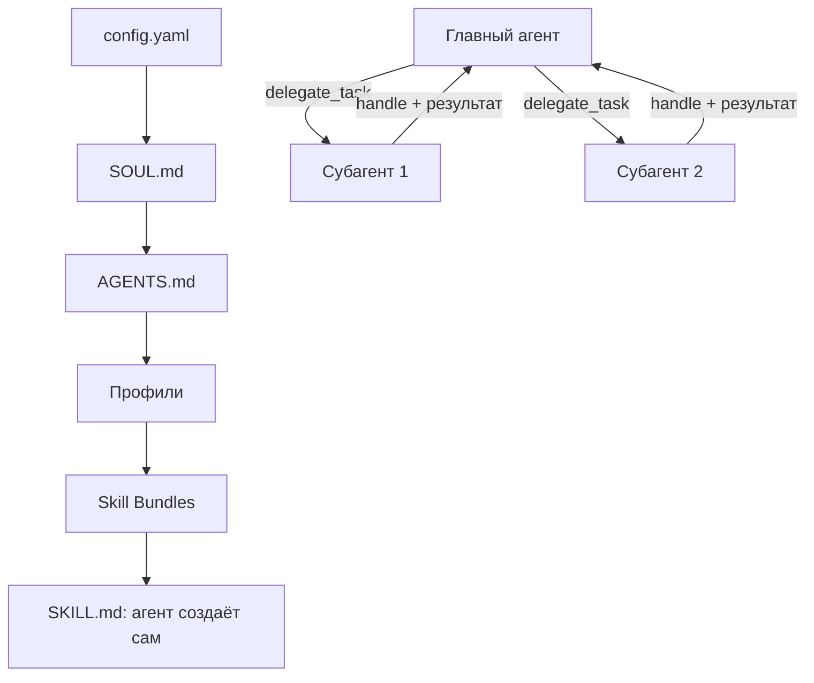

# Hermes (Nous Research)

> [!info] Определение
> Открытая агентная платформа Nous Research: gateway + профили + скиллы +
> субагенты. Самая развитая **иерархия скиллов** среди сред: агент сам создаёт
> и развивает процедурную память. См. [[Назначение скиллов субагентам]],
> [[Паттерны оркестрации]].

## Иерархия скиллов Hermes (ключевая особенность)

```
config.yaml + .env + auth.json   ← конфигурация и провайдеры
        ↓
SOUL.md                          ← личность/характер агента
        ↓
AGENTS.md                        ← правила проекта
        ↓
Профили (profiles)               ← модель, память, инструменты, скиллы на агента
        ↓
Skill Bundles (YAML)             ← группы скиллов за одной slash-командой
        ↓
SKILL.md (agentskills.io)        ← процедурные скиллы; агент создаёт сам
```

| Уровень | Что это | Кто пишет |
|---|---|---|
| config.yaml / .env / auth.json | Провайдеры, ключи, лимиты | Администратор |
| SOUL.md | Личность агента («кто я») | Человек |
| AGENTS.md | Правила проекта | Человек (запись — с approval) |
| Профиль | Модель, память, доступ к инструментам, набор скиллов | Человек/агент |
| Skill Bundle | YAML-группа скиллов за одной командой | Человек/агент |
| SKILL.md | Процедурная память: как делать задачу | **Сам агент** (создаёт и развивает) |

> [!warning]
> Записи в AGENTS.md, скиллы и память всегда требуют approval (security wave v0.21).
> Агент не может молча переписать собственные правила.

## Субагенты: delegate_task

- **Live orchestration**: `delegate_task` — list детей, steer mid-flight (коррекция курса),
  stop с сохранением частичного результата.
- **Background**: субагент возвращает handle сразу; результат возвращается как новый ход.
- **Лимиты** (config.yaml → delegation):
  - `max_concurrent_children` (по умолчанию 10) — ширина параллелизма;
  - `max_spawn_depth` (по умолчанию 1) — глубина рекурсии;
  - `max_iterations` (250), `child_timeout_seconds` (600).
- **Разные модели**: оркестратор — reasoning-модель (kimi-k2.6), субагенты — execution-модель
  (glm-5.1). Оркестрация и исполнение — разные когнитивные задачи.

## Паттерны координации

| Паттерн | Описание |
|---|---|
| Hub-and-spoke | Главный агент — CEO; субагенты — руководители отделов |
| Worktree Mode | Дерево независимых агентов, каждый в своём контексте |
| Kanban | Карточки с assignee (профиль), dispatcher спавнит агента в чистом workspace |
| Pipeline | Architect → Developer → QA → DevOps |
| Consensus (oh-my-hermes) | Planner → Architect → Critic до согласия; Executor → Verifier |

## oh-my-hermes: эталон сложной системы

- **10 скиллов**: ralplan (консенсус-планирование), ralph (верифицированное исполнение),
  deep-research, deep-interview, triage, autopilot + driver-скрипты.
- **15 ролей**: Planner, Architect, Critic, Executor, Verifier, Analyst, Security Reviewer…
- **Железные законы**: «evidence, not assertion» (нет вывода теста — не пройдено);
  three-strike circuit breaker (стоп после 3 одинаковых ошибок).
- **Разделение**: «дисциплина рабочего» (skill) vs «скрипт бригадира» (driver skill).

## Пример: конфигурация делегирования

```yaml
delegation:
  model: 'glm-5.1:cloud'
  provider: 'ollama-agents.ictq.xyz'
  max_iterations: 50
  child_timeout_seconds: 600
  max_concurrent_children: 3
  max_spawn_depth: 1
  orchestrator_enabled: true
  subagent_auto_approve: true
```

## Диаграмма



## Мнемоника

**«Конфиг, Душа, Правила, Профиль, Скиллы»** — КДППС.

## Связи

- [[Назначение скиллов субагентам]] · [[Паттерны оркестрации]] · [[Модели и стоимость]] · [[Kilo Code]] · [[Claude Code]] · [[Справочник сред]]

## Типичные ошибки

> [!warning]
> max_spawn_depth > 1 без нужды: отладка рекурсии сложна. Все скиллы включены в профиле:
> шум в контексте (рекомендация сообщества: 15–20 скиллов на профиль). Субагент без
> скоупа инструментов: least privilege нарушен.
