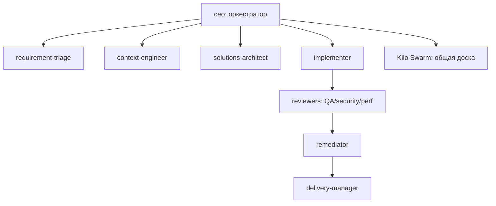

# Kilo Code

> [!info] Определение
> Агентная среда на ядре OpenCode Server (VS Code extension + CLI + Cloud).
> Субагенты — нативно: агенты с полным доступом делегируют через task tool.
> См. [[Паттерны оркестрации]], [[Изоляция и worktrees]].

## Субагенты

- **Orchestrator mode deprecated**: агенты Code, Plan, Debug сами запускают субагентов
  (general — автономная работа, explore — исследование кодовой базы).
- **Custom subagents**: свои агенты под workflow команды (security review, migration, linting).
- **Параллелизм**: несколько субагентов одновременно (implementation + tests + docs),
  результаты конденсируются в родителя.
- **Foreground/background**: foreground возвращает результат до продолжения родителя;
  background — родитель продолжает, результат приходит позже.

## Agent Manager и изоляция

- **Agent Manager** — панель управления: вкладки-агенты, мониторинг, переключение контекста.
- **Git worktrees** — каждый агент в своей копии репозитория; параллельная работа без конфликтов.
- **Kilo Swarm** — главная сессия и потомки обмениваются находками на общей доске
  (включено по умолчанию; `shared_agent_board: false` в kilo.jsonc).
- **Multi-model comparisons** — один промпт на разных моделях, сравнение рядом.

## Tool-enforced pipeline (16 агентов)

Структурированный пайплайн: triage → context-gather → design → implement → integrate →
review → remediate → deliver. Стадии enforced через Task() tool, а не текст промпта.

| Агент | Роль |
|---|---|
| ceo | Главный оркестратор |
| requirement-triage | Классификация задачи, оценка риска |
| context-engineer | Сбор и синтез контекста |
| solutions-architect | Технический дизайн |
| implementer | Реализация по слайсам |
| integrator | Межфайловая консистентность |
| qa-reviewer / security-reviewer / performance-reviewer | Ревью по измерениям риска |
| remediator | Исправление находок ревью |
| delivery-manager | Проверка приёмки и чистка |

## Назначение скиллов субагентам

- Скиллы: `.kilo/skills/` (pipeline skills) + agents.json (bundle для импорта).
- Модель субагентов: `subagent_model` в kilo.jsonc (дешёвая модель для исполнителей,
  сильная — для ceo).

## Диаграмма

## Мнемоника

**«Триаж, Контекст, Дизайн, Реализация, Ревью, Исправление, Доставка»** — ТКДРИРД.

## Связи

- [[Hermes]] · [[Паттерны оркестрации]] · [[Изоляция и worktrees]] · [[Модели и стоимость]] · [[Справочник сред]]

## Типичные ошибки

> [!warning>
> Использование deprecated orchestrator mode вместо нативной делегации. Параллельные
> агенты в одном worktree при write-heavy задачах: конфликты. Субагент без скоупа файлов.
