# Манифест агентной software factory

> [!note] Единственное расположение
> Этот манифест хранится одним файлом в корне проектируемой песочницы: `<sandbox-root>/Манифест агентной software factory.md`. Копии манифеста в энциклопедиях, каталогах документации и подпапках не создаются; другие материалы ссылаются на этот корневой файл.

> [!abstract] Статус
> Черновой набор принципов для совместного штурма. Это не финальная архитектура и не tool choice.
> Решения должны пройти проверку на нашем workflow, репозиториях, рисках и стоимости.

## Цель

Преобразовывать внешние продуктовые задачи в проверяемые, безопасные изменения ПО и обратимые релизы;
сохранять контекст проекта так, чтобы люди и агенты могли понять **что система делает, почему и как это
проверить**, не перечитывая историю чатов.

## Базовые принципы

1. **Система записей важнее чата.** Решения, статус, ownership и результаты хранятся в устойчивых задачах,
   PR/commits, документации и журнале запусков. Чат — интерфейс, не база фактов.
2. **Не дублируем истины.** Внешний backlog хранит продуктовый intent и приоритеты; репозиторий хранит
   код, контракты и принятые правила проекта; внутренняя очередь хранит только декомпозицию/исполнение,
   связывая каждую работу с родительской внешней задачей.
3. **Код — источник наблюдаемого поведения, не всего смысла.** API, tests, schemas, migrations и runtime
   показывают, что сейчас исполняется; бизнес-смысл, исключения и намерения фиксируются отдельно и имеют owner/source.
4. **Документация — версия-aware модель проекта.** Канонические сущности, флоу, бизнес-правила и архитектурные решения собраны в общей `.doc/architecture/` вне Git-репозитория продукта; каждая страница явно описывает применимость по релизам и происхождение изменений.
5. **Изменение правила связывает код и docs.** Если задача меняет бизнес-правило, контракт, флоу или исключение, обновляются tests и canonical doc с Jira task/stage, target release, code PR/commit и test evidence. Кодовый PR и изменение docs могут жить в разных хранилищах, но должны быть связаны и human-reviewed до релиза.
6. **Текущее состояние и история разделены, но связаны.** Одна canonical страница на сущность/правило/флоу показывает active behavior по всем релизам; встроенный `doc_revision` и append-only change log связывают каждую смену состояния с Jira-задачей и релизом. История документа не зависит от истории продукта в Git.
7. **Задача агента — контракт.** Scope, parent ID, acceptance criteria, ограничения, полномочия, доказательства,
   stop conditions и reviewer должны быть явными до исполнения.
   Целевой стандарт фабрики — **100% обязательных сценариев на проверенном снимке при минимальном необходимом контексте**. Даже маломощная модель должна уметь превратить запрос в проверяемую задачу по короткому маршруту и точным источникам. Исполнителю должно хватать карточки и её ссылок без истории чата. Поддерживайте этот стандарт явными оракулами и проверками CLI. Неоднозначный результат блокирует затронутый шаг. Измеряйте постановку и реализацию отдельно на сопоставимых задачах, проверяя полноту, ошибочные записи, first-pass acceptance, затраты и повторную работу. [Поток постановки](../domains/task-intake/flows/create-task.md)
8. **Один владелец изменения и один агент в MVP.** Каждая задача имеет owner и bounded scope; текущий flow
   исполняет один агент. Multi-agent concurrency не является требованием ядра; возможное будущее параллельное
   выполнение допустимо только для доказуемо независимых работ с контролируемой интеграцией.
9. **Память не равна доступу.** Retrieval/context соблюдает permissions, tenant/repo boundary, freshness и provenance.
   Текстовые инструкции не заменяют runtime authorization.
10. **Мягкие инструкции не являются security gates.** Least privilege, sandbox, policy-as-code, protected branches,
    независимые CI проверки и approval для риска обеспечиваются системно, а не просьбой к модели.
11. **Результат доказывается.** Изменение проходит релевантные unit/contract/property/integration/security/performance
    checks. Агент не может единолично менять защищённый acceptance oracle и объявлять свою работу проверенной.
12. **Автономность растёт по evidence и риску.** Начинаем с read-only/предложений; права на запись, merge и deploy
    разделены. Для high-impact изменений нужны явный владелец решения, rollout, мониторинг и rollback.
13. **Оптимизируем shipped value и устойчивость.** Не максимизируем PR count, lines, tokens или agent throughput.
    Считаем качество, стабильность, reviewer effort, lead time, стоимость, rework и последствия для пользователей.
14. **Простой инструмент — стартовая точка.** Выбираем tooling после определения границ, workflow и evals;
    используем адаптеры, не привязывая доменную модель к одному вендору без обоснования.
15. **Детерминированные операции — в CLI, смысловая работа — агенту/модели.** Повторяемые операции с известными
    структурированными входами выносятся в CLI-инструменты на Python или shell; интерпретация намерений,
    поиск по смыслу, анализ архитектуры и выбор контекста выполняются моделью по skills/instructions. CLI не
    имитирует семантическое понимание эвристиками, масками или неявной классификацией.
16. **Модели вызываются через явные роли и policy.** Набор model endpoints и role→model mapping настраивается
    конфигурацией; агентская skill решает, нужен ли вызов и формирует смысловую инструкцию. Model CLI —
    управляемый интерфейс вызова/возврата, а не самостоятельный task orchestrator и не источник полномочий.

17. **Архитектурная документация должна быть достаточно полной для пересборки системы.** Если оставить
    только архитектурную документацию (`doc/architecture/`, `doc/config/task-conf/`, `doc/config/paths.yaml`,
    `doc/tools/arch/` спецификации и существующие task.json), без исходного кода CLI и без доступа к чату,
    команда должна быть способна построить эквивалентную систему по тем же принципам: один agent, детерминированный
    CLI, task.json как единственный canonical input, task-conf иерархия, конфиг-driven валидация, контроль закрытия
    задач через subtask_policy/close_policy, детектор мусора `docs paths --check`. Документация должна содержать
    все сигнатуры, форматы файлов, exit-коды, reglas валидации и процедуры, необходимые для восстановления
    функциональной эквивалентности — без угадывания смыслов, которые принадлежат агенту/скиллам, но с полной
    детерминированной спецификацией всего, что CLI делает.

## Четыре слоя, которые нужно спроектировать

| Слой | Назначение | Минимальный контракт |
|---|---|---|
| **1. Интеграция внешних задач** | Приём intent/priority, обратная ссылка, статусы результата | External ID, project/team, description, acceptance, priority, owner, status, source URL |
| **2. Task lifecycle (MVP: один агент)** | Нормализованная задача, state, стадии/попытки, остановка и возобновление одного исполнения | `task.json`, source ID, scope, state/artifact refs, retry/stop rule; dependency graph и multi-agent assignment — вне текущего ядра |
| **3. Project knowledge model** | Описывает текущие сущности, флоу, правила и архитектурные решения | Stable IDs, canonical page, source/provenance, validity/version, owner, linked tests/code |
| **4. Execution & verification** | Sandbox/worktrees, tool permissions, CI, evidence, promotion/release | Pinned commit, isolated changes, test/scans, verifier identity, approval, rollout/rollback |

Это логические области ответственности, не требование вводить четыре физических базы/сервиса или отдельные agent roles. В MVP один агент выполняет планирование/изменение последовательно; CI и человек обеспечивают независимые проверки/approval. Multi-agent task graph не проектируется сейчас.

## Черновой end-to-end поток

```mermaid
flowchart LR
    EXT[Tracker или chat] --> ADAPTER[CLI: fetch + exact field mapping]
    ADAPTER --> SKILL[Agent skill: понять intent / уточнить]
    SKILL --> TASK[Единственный task.json]
    TASK --> CLI[CLI: validate + workspace + branch + records]
    CLI --> AGENT[Один bounded agent в task branch]
    AGENT --> CODE[Код + executable tests]
    AGENT --> DELTA[Смысловые docs/spec deltas при необходимости]
    CODE --> CLI2[CLI: diff + test/evidence capture]
    DELTA --> OWNER[Owner review смысла/docs]
    CLI2 --> VERIFY[Acceptance/CI + review человеком]
    OWNER --> VERIFY
    VERIFY -->|доработка| AGENT
    VERIFY -->|согласовано| PR[Человек публикует/одобряет PR]
    PR -->|human merge| RELEASE[Соответствующая release branch]
    RELEASE --> RECORD[Release/evidence record]
    RECORD --> EXT
```



## Зафиксированная вводная: любой источник или ручная постановка → task.json → задача/ветка/release branch

Фабрика принимает задачи из Jira, других подключённых задачников и вручную через чат. Все входы приводятся к единому, версионируемому `task.json`; это единственный canonical task input для ядра. Отдельный вручную сопровождаемый `task.md` не создаётся. Все данные, необходимые детерминированным CLI-командам для создания task workspace, путей, ветки и task artifacts, должны быть представлены в `task.json` либо в versioned project configuration, на которую он ссылается. Человекочитаемый текст может быть выведен как generated view из JSON, но не является параллельным источником истины.

1. **Адаптеры источников и CLI.** Для каждого tracker CLI получает структурированные поля, comments/updates и attachments через соответствующий adapter, сохраняет исходный snapshot/provenance и выполняет только явное field mapping в общий schema. Неизвестные поля сохраняются как source data или явно маркируются unmapped; CLI не делает выводов о смысле задачи, её полноте или приоритете. Добавление источника — adapter + mapping/schema tests, без скрытого semantic classifier. Чтение источника по умолчанию read-only.
2. **Постановка пользователем (UI / user input).** Навык `create task` ведёт диалог: понимает намерение, выявляет неоднозначности, задаёт необходимые вопросы и формирует полный `task.json` с `source.type: ui`, source/provenance и всеми известными полями. `ui` означает пользовательский ввод в чате/вручную, а не подключение к графическому интерфейсу. Это смысловая работа агента согласно skill/instructions, не shell/Python эвристика. CLI затем валидирует JSON, безопасно создаёт task directory и сохраняет input. Недостающие блокирующие данные не выдумываются: skill возвращает вопрос/ожидает ответ либо помечает поле как `unset` только когда это допустимо.
3. **Единственный task input.** `task.json` содержит стабильную task identity: обязательный четырёхзначный десятичный `task_number` и детерминированный `task_key`, а также source/native ID/URL/revision/snapshot, title/intent, task kind при наличии, scope и exclusions, acceptance criteria с oracle/verification refs, project context refs, release target, ограничения/assumptions/open questions и требуемые approvals/owners. Он также содержит ссылки/IDs исходных comments/attachments и параметры, необходимые для детерминированного scaffold/branch selection. Полный schema/required fields будут специфицированы отдельно. CLI проверяет структуру/согласованность типов, но не оценивает качество смысла; agent skill отвечает за semantic completeness.
4. **Task identity и folder.** Каждая задача имеет ровно четырёхзначный десятичный `task_number` (`0000`–`9999`); `task_key` и имя каталога строятся детерминированно из источника и этого номера: Jira — номер без префикса (например, `2045`); пользовательский ввод (`source.type: ui`) — `UI-2045`; любой другой источник — `<source-prefix>-2045` с обязательным явно настроенным префиксом. Нативный ID/URL сохраняется отдельно как provenance и не заменяет task number. CLI проверяет формат, правила префиксов, коллизии и безопасные пути, но не изобретает/не выделяет номер; пока нет утверждённого allocator/registry, отсутствующий номер, конфликт или неоднозначность — stop. Jira остаётся без префикса по умолчанию; обнаруженная коллизия не разрешается добавлением префикса молча.
5. **Snapshot и обновления.** `task.json` хранит нормализованный execution snapshot и source provenance; raw source payload хранится/ссылается отдельно в определённом формате, вложения — в `attachments/` с исходными именами/метаданными и безопасными локальными именами. Исходный tracker остаётся внешним source of truth, но текущий run опирается на зафиксированный snapshot. CLI выявляет технический факт изменения revision/hash и сообщает о drift; агент оценивает семантическое влияние изменения, задаёт вопросы и решает, нужен ли новый scope/stage. Никаких автоматических записей обратно в tracker без отдельного решения.
6. **Запуск работы.** Пользователь вызывает `go to task <task_key>` либо `create task`. Skill/агент выбирает необходимый контекст и формулирует план по смыслу. CLI предоставляет предсказуемые команды для чтения/валидации task JSON, проверки repo/worktree/Git состояния и подготовки workspace. CLI не выбирает релевантные модули или архитектурные документы по fuzzy matching; это делает агент с правилами поиска в skill и ссылается на найденные evidence.
7. **Release target и ветка.** Release-to-branch mapping хранится в project configuration; `task.json` содержит target release либо явное `unset`. CLI детерминированно разрешает точное соответствие, проверяет наличие/допустимость ветки и создаёт/checkout-ит task branch по safe naming rule на основе `task_key` (например, `futures/2045`, `bugfix/UI-2045`); веточные классификаторы и префиксы задаются отдельной политикой. Отсутствующий/неоднозначный mapping — ошибка/stop с сообщением, не угадывание. CLI фиксирует base commit, target branch и derived branch в task metadata/execution record. Существующие dirty changes не перезаписываются.
8. **Стадии и итерации.** Каталог `doc/tasks/<task_key>/stageN/` и предопределённые структурированные artifact templates создаются CLI по команде/валидному task JSON. Agent skill исследует задачу и наполняет семантические plan/context/architecture delta artifacts; CLI не генерирует смысловое содержание и не решает, какие сущности/правила затронуты. Новый tracker comment/review finding — событие/snapshot для агента; skill оценивает, меняется ли intent/scope и нужна ли следующая стадия.
9. **Review artifacts и публикация.** CLI строит точные code/stage diffs из Git refs, собирает status/test exit codes и пишет машинно-читаемые execution evidence по схеме. Если нужен человекочитаемый обзор, он генерируется из task JSON + refs/evidence, не редактируется как отдельный source of truth. Агент выполняет semantic review изменений, архитектурного смысла и test coverage; человек одобряет PR/merge/release. CLI может подготовить commit/PR только по отдельной команде и политике; push, merge и deploy запрещены по умолчанию и не происходят автоматически.

## Типы задач (task_type) и их влияние на workflow

Каждая задача имеет `task_type`, определяющий характер работы, глубину анализа и требования к верификации.

### Конфигурация типов и потоков (task-conf)

Структура, что именно лежит в задачах, задаётся иерархической конфигурацией в `doc/config/task-conf/`. Каждый тип — папка `types/<type>/` с двумя файлами:

- `config.yaml` — конфиг типа: `id`, `title`, `description`, `complexity_default`, `complexity_allowed`, `allowed_flows`, `default_flow`, `subtask_policy`, `close_policy`, `required_fields`, `forbidden_in_scope`.
- `prompt.md` — стартовый промпт типа (по принципу скилла), исполняемый при начале работы над задачей этого типа.

Внутри типа подпапка `flows/<flow>/` с файлами:

- `config.yaml` — конфиг flujo: `id`, `title`, `type`, `description`, `subtask_policy`, `close_policy`, `steps` (с `id`/`name`/`action`/`output`/`gate`).
- `prompt.md` — стартовый промпт flujo, регламентирующий, как агент выполняет задачу этого типа и этого flujo.

Такой подход означает: **структура конфига задаёт, что лежит в задачах** — allowed_flows определяет, какие flujo доступны для типа; subtask_policy (required/optional/forbidden) — нужно ли создавать подзадачи; close_policy — может ли задача закрыться при незакрытых подзадачах; required_fields — какие поля task.json обязательны; steps с gates — порядок действий и условия перехода между этапами.

| task_type | Назначение | Характер работы | Потоки (flows) | Подзадачи | Закрытие |
|---|---|---|---|---|---|
| `jira-incoming` | Вcoming задача из Jira | Нормализация в task.json, работа через единственный flujo процесса | `jira-process` | required | все подзадачи должны быть закрыты |
| `research` | Исследование, анализ, ресёрч | Сбор информации, сравнение подходов, выводы | `research-first` | optional | все подзадачи должны быть закрыты |
| `planning` | Планирование, декомпозиция | Составление плана, impact map, зависимости | `research-first`, `standard-implementation` | optional | все подзадачи должны быть закрыты |
| `audit` | Аудит, проверка соответствия | Проверка кода, документации, архитектуры | `research-first` | optional | все подзадачи должны быть закрыты |
| `feature` | Новая функциональность | Реализация нового поведения | `standard-implementation`, `research-first` | required | все подзадачи должны быть закрыты |
| `bugfix` | Исправление дефекта | Исправление существующего поведения | `standard-implementation`, `minimal-scaffold` | optional | все подзадачи должны быть закрыты |
| `docs` | Документация | Изменение архитектурных/проектных документов | `docs-only` | optional | все подзадачи должны быть закрыты |
| `refactor` | Рефакторинг | Изменение кода без изменения поведения | `standard-implementation`, `minimal-scaffold` | optional | все подзадачи должны быть закрыты |
| `scaffold` | Создание заготовки | Инициализация структуры, шаблоны | `minimal-scaffold` | forbidden | все подзадачи должны быть закрыты |

### Поля task.json, добавленные структурой task-conf

Каждый `task.json` содержит дополнительные поля, определяемые конфигом типа/флоу:

- **`task_type`** — один из зарегистрированных типов (см. `arch task types`).
- **`flow`** — идентификатор flujo, закреплённый за задачей; должен быть в `allowed_flows` для выбранного `task_type`. CLI валидирует совместимость при `arch task validate`.
- **`complexity`** — `low` / `medium` / `high` / `critical`; стартовое значение берётся из `complexity_default` типа.
- **`subtasks`** — массив `{id, title, status, path}`; задаётся при декомпозиции через `arch task decompose`.

`task_type` влияет на глубину ревью и обязательные поля. Точный перечень полей задают `paths.yaml` и `required_fields` выбранного типа. Для аудита сохраняйте findings и основания, для планирования — зависимости и приёмку. Для документации глубину проверки определяет затронутый контракт, для рефакторинга нужна проверка сохранённого поведения.

Владелец задачи или агент через skill определяет `task_type` и `flow` при создании; CLI валидирует enum, не интерпретирует смысл. Стартовые промпты читаются командами `arch task type-prompt --type <type>` и `arch task flow-prompt --type <type> --flow <flow>`.

Требование к приёмке реализации — каждый обязательный AC родителя и детей имеет целевую проверку. В плане указывают проверяемый вход, действие, результат и состояние после операции. Общий прогон подтверждает совместимость, а покрытие конкретного AC подтверждает его целевая проверка. Сбой, пропуск или устаревший снимок оставляет критерий открытым. [Поток выполнения](../domains/task-lifecycle/flow.md)

## Контроль закрытия задач на уровне CLI

Задача с `close_policy: all_subtasks_required` (все текущие типы) может быть закрыта только через `arch task close <task_key>` после выполнения двух условий:

1. Все подзадачи в `doc/tasks/<task_key>/subtasks/<subtask_id>/` имеют `phase: completed`.
2. Получен approval владельца задачи.

`diagnose` и `close` используют общие машинные предусловия. Агент отдельно сверяет приёмку и одобрение. Подробности в [описании жизненного цикла](../domains/task-lifecycle/flow.md).

### Требования к информированности вывода CLI

Вывод CLI должен быть настолько информативным, чтобы агент мог принять решение о следующем действии без чтения логов модели. Полная спецификация — в `doc/architecture/system/architecture-contract.md`, раздел 8.4. Ключевые требования:

- **Короткий успех проверки.** В компактном режиме одна строка сообщает, какая проверка и область прошли. При отказе команда должна показать причину, место и следующий проверяемый шаг. Массовый вывод можно ограничить, указав общее число проблем и способ получить остаток.
- **Компактность по назначению.** Проверка отвечает на вопрос о результате. Запрос состояния возвращает нужные данные и ссылки на артефакты. Выдачу JSON сохраняйте совместимой: exit code, envelope и обязательные поля проверяются тестами.
- **У каждого проектного CLI есть краткий скилл оператора.** Он описывает точку входа, типовые сценарии, нужные флаги, выход и побочные эффекты. Агент использует скилл и точечный `--help`. Исходники читает только при изменении CLI или диагностике воспроизводимого расхождения с интерфейсом. Изменения публичной команды сопровождаются обновлением справочника и проверки её контракта. Текущий пример — [arch-cli](../../skills/arch-cli/SKILL.md).
- **Правило входа доступно с корня проекта.** [Корневой AGENTS.md](../../../AGENTS.md) направляет оператора к публичному контракту CLI. Клиентские настройки подключения навыков и прав живут в конфиге клиента и проверяются отдельно. Для Kilo проект предоставляет профиль чтения `factory-operator` в [kilo.jsonc](../../../kilo.jsonc).
- **Минимальный цикл работы.** Начинайте с точного ключа или критерия приёмки. Читайте нужные источники и вызывайте целевую проверку. Полный прогон выполняйте на итоговом снимке. В evidence сохраняйте команду, исход, проверенный снимок и покрытые AC. Полный лог храните по ссылке, когда он нужен для разбора.
- **Архитектура участвует в приёмке.** Типовой flow собирает ограничения манифеста и действующие правила до реализации. Свяжите точный раздел с AC, CASE или проверкой границ. После целевой проверки обновите затронутые записи или зафиксируйте, почему правило сохранено. Итоговый снимок проверяется по этим же правилам. [Этапы flow](../domains/task-lifecycle/flow.md#архитектура-в-этапах-типового-flow)

- Структурированный JSON-вывод (`--json`), единственный envelope ответа, `--fields`/`--quiet`/`--brief` для экономы токенов.
- Семантические exit-коды (0/1/2/5/10/20/75) как control flow агента.
- Actionable ошибки с `code`, `message`, `field`, `suggestion`, `exit_code`.
- `--help` как контракт с примерами (≤ ~1500 токенов).
- `--dry-run` со структурированным diff, `--yes/--force` для деструктивных операций.
- TTY-aware вывод: rich для человека, clean JSON для агента (non-TTY).
- Sekrety только через env/secret store, never через флаги или task JSON.

Источники в `data/`: `cli-skills-encyclopedia/Практики/Agent-Friendly CLI Design.md`, `Примеры/Пример agent-friendly CLI.md`, `Форматы/Help-текст CLI.md`, `Практики/Токен-эффективность.md`.

## Единый E2E поток с task-conf и flujo

```mermaid
flowchart LR
    EXT[Tracker или chat] --> ADAPTER[CLI: fetch + exact field mapping]
    ADAPTER --> SKILL[Agent skill: понять intent / уточнить]
    SKILL --> TASK[Единственный task.json + task_type + flow + complexity]
    TASK --> CONF[task-conf: type config + flow config\nпроверка allowed_flows / subtask_policy / close_policy]
    CONF --> PROMPT[Стартовый промпт типа и flujo\nкак скилл агента]
    PROMPT --> CLI[CLI: validate + workspace + branch + records]
    CLI --> AGENT[Один bounded agent в task branch]
    AGENT --> DECOMP[arch task decompose — подзадачи при subtask_policy: required]
    DECOMP --> CODE[Код + executable tests]
    AGENT --> DELTA[Смысловые docs/spec deltas при необходимости]
    CODE --> CLI2[CLI: diff + test/evidence capture]
    DELTA --> OWNER[Owner review смысла/docs]
    CLI2 --> VERIFY[Acceptance/CI + review человеком]
    OWNER --> VERIFY
    VERIFY -->|доработка| AGENT
    VERIFY -->|согласовано| CLOSE[arch task close — проверка subtasks]
    CLOSE -->|human merge| PR[Человек публикует/одобряет PR]
    PR -->|human merge| RELEASE[Соответствующая release branch]
    RELEASE --> RECORD[Release/evidence record]
    RECORD --> EXT
```




## Субтаски: декомпозиция и иерархия задач

Задача может быть декомпозирована на субтаски в каталоге `doc/tasks/<task_key>/subtasks/<subtask_id>/`. Каждый субтаск имеет собственную структуру, идентичную задаче:

```
doc/tasks/<task_key>/
├── task.json                 # единственный canonical input + subtasks массив
├── stage1/                   # план и верификация родительской задачи
│   ├── plan.md
│   └── verification.json
└── subtasks/
    ├── 0001/                 # subtask_id уникален только внутри родителя
    │   ├── task.json         # parent_task_key ссылается на родителя
    │   └── stage1/
    │       ├── plan.md
    │       └── verification.json
    │   └── subtasks/         # рекурсия: у субтаска могут быть свои субтаски
    │       └── 0001/
    └── 0002/
```

**Правила работы с субтасками:**

1. **Субтаски всегда ручные** — нет привязки к внешним источникам (Jira, трекеры и т.д.). `source.type` для субтаска — `ui` с ручной постановкой, `task_number` — 4 цифры в пределах родителя.
2. **Нумерация уникальна только внутри родителя** — `0001`, `0002` … не конфликтуют с нумерацией других родительских задач.
3. **`parent_task_key`** — каждый субтаск имеет поле `parent_task_key`, ссылающееся на родительскую задачу. Обратная ссылка записывается в поле `subtasks` родительского `task.json` как массив `{id, title, kind, status, path}`.
4. **Рекурсия** — у субтаска могут быть свои субтаски в своей папке `subtasks/`. Глубина иерархии не ограничена, но каждый уровень должен иметь обоснование.
5. **`depends_on`** — массив task/subtask ключей, от которых зависит задача. Зависимости разрешаются перед началом исполнения; циклические зависимости — ошибка.
6. **`phase`** — этап жизненного цикла: `intake` / `planning` / `execution` / `verification` / `completed` / `blocked`. Агент восстанавливает работу с последней незавершённой стадии.
7. **`rollback_plan`** — описание отката изменений; обязательно для задач с риском medium/high/critical.

**Разделение ответственности для субтасков:**
- CLI создаёт каталог `subtasks/<id>/`, шаблон `task.json`, валидирует структуру, проверяет коллизии и enum-поля
- Скилл (`go-to-task`) принимает решение о декомпозиции, заполняет смысловые поля (`intent`, `scope`, `related_docs`, `related_tests`), определяет зависимости

## Исследовательская папка задачи: `research/`

Внутри каждой задачи может быть папка `doc/tasks/<task_key>/research/` со свободными Markdown-документами для исследований, гипотез, ссылок на кодовую базу и внешние источники (интернет). Это место для сбора сырой информации, которая ещё не превратилась в принятое решение или канонический документ.

### Структура и связь с задачей

Каждый файл研究 — `doc/tasks/<task_key>/research/<slug>.md` (шаблон декларирован в `doc/config/paths.yaml`). Связь с задачей фиксируется в поле `research_docs` родительского `task.json` — массив объектов:

```json
{
  "id": "res-001",
  "title": "Гипотеза о кэшировании заказов",
  "path": "doc/tasks/UI-0009/research/order-cache-hypothesis.md",
  "source_type": "web",
  "source_ref": "https://example.com/article",
  "summary": "Почему кэширование заказов может снизить нагрузку на БД на 40%",
  "status": "hypothesis"
}
```

### Поля research_docs

| Поле | Описание |
|------|----------|
| `id` | Стабильный идентификатор исследования внутри задачи |
| `title` | Человекочитаемое название |
| `path` | Абсолютный путь к `.md` файлу, должен быть под `doc/tasks/<task_key>/research/` и заканчиваться на `.md` |
| `source_type` | `web` — интернет-источник; `code` — кодовая база; `internal` — внутренний документ/знание |
| `source_ref` | URL, путь к коду или ссылка на внутренний документ |
| `summary` | Краткое суть исследования / гипотезы |
| `status` | `hypothesis` — недоказанная гипотеза; `confirmed` — подтверждено evidence; `rejected` — опровергнуто; `archived` — больше не актуально |

### Правила работы с research/

1. **Свободное содержимое** — внутри `.md` файлов можно фиксировать любые гипотезы, ссылки, выдержки из кода, заметки из интернета, черновики.
2. **Не каноническая документация** — research-файлы не являются канонической архитектурной документацией. Если исследование приводит к принятому решению, соответствующий канонический документ (сущность, флоу, правило, ADR) создаётся отдельно в `doc/architecture/` с ссылкой на research-файл как на источник.
3. **Связь с таском** — каждый research-файл регистрируется в `research_docs` родительского `task.json`; без регистрации файл считается не 연결ным к задаче и выявляется валидатором.
4. **CLI не семантически анализирует** — CLI только проверяет путь, наличие обязательных полей и корректность `source_type`/`status`. Семантическую оценку гипотез и их подтверждение/опровержение выполняет агент/скилл.
5. **Подзадачи могут иметь свои research/** — рекурсивно, каждая подзадача может иметь свою папку `research/` с собственными файлами.

### Пример task.json с полями типов и субтасков

```json
{
  "task_key": "UI-0001",
  "task_number": "0001",
  "task_type": "feature",
  "phase": "planning",
  "risk": "medium",
  "subtasks": [
    {"id": "0001", "title": "Исследовать существующий код", "kind": "research", "status": "completed", "path": "subtasks/0001"},
    {"id": "0002", "title": "Реализовать изменение", "kind": "feature", "status": "intake", "path": "subtasks/0002"}
  ],
  "depends_on": [],
  "rollback_plan": "Откатить изменения в affected files через git revert при неудаче верификации",
  "related_docs": ["ENT-example-name", "FLOW-example-flow"],
  "related_tests": [{"test_id": "AC-1", "suite": "unit", "location": "tests/test_example.py", "command": "pytest tests/test_example.py"}]
}
```

### Разделение ответственности: CLI (Python/shell) и агентские skills

**Разумное распределение технологий:** Python — основной язык CLI для JSON/schema validation, tracker adapters, безопасной нормализации IDs/paths, filesystem/Git операций, artifact generation и evidence reports. Shell (`sh`) — только тонкие entrypoints/wrappers и простая композиция процессов; вся логика и правила остаются в одном Python-источнике, без дублирования в shell. Если окружение требует shell-only, это отдельное ограничение реализации, не повод создавать второй набор правил.

**CLI делает всё, что является детерминированной операцией над явными структурированными входами:**

- получает и сохраняет tracker records/comments/attachments через source adapters; точное field mapping; идентификаторы revisions, timestamps, hashes и provenance;
- парсит JSON, валидирует JSON Schema/version/required fields/enums/ссылки/формальные invariants и показывает ошибки с JSON path; мигрирует schema только через явные versioned migrations;
- генерирует task key/безопасные paths/branch names по утверждённым правилам; обнаруживает технические коллизии; создаёт каталоги/artifact templates и пишет machine metadata;
- выполняет точные Git операции: status, fetch, checkout/create branch только от заданного target, фиксирует base/head SHA, вычисляет diff по конкретным refs, не теряя tracked/staged/unstaged/untracked state по явно заданной политике;
- запускаетNamed/разрешённые команды и тесты, собирает exit code/stdout/stderr/artifact refs; формирует проверяемые JSON reports и ссылки на тяжёлые outputs;
- сравнивает source revision/hash для обнаружения факта изменения; проверяет существование файлов/IDs/локальных ссылок, task/source/stage refs и закрытый набор статусов/переходов, если он специфицирован;
- строит/проверяет общий docs index из явных metadata, проверяет uniqueness IDs, frontmatter/schema, локальные ссылки/anchors и связи task↔stage↔architecture page; сообщает о разрывах, не решая смысловую релевантность или правильность выбранного раздела;
- даёт CLI help/usage, list/show/status/validate/sync/render/init и idempotent operations с понятными ошибками, dry-run где уместно и атомарной записью файлов.

**Один агент в текущем ядре работает над смыслом через skills/instructions и доступные инструменты (subagent — только возможное будущее расширение):**

- извлекает intent из чата/issue/comments, нормализует смысловые поля в `task.json`, замечает неоднозначность/конфликт и задаёт вопросы;
- оценивает достаточность/проверяемость критериев, scope, рисков, assumptions и нужных approvals; не маскирует неизвестность;
- семантически ищет релевантные модули, code patterns, project docs, сущности, архитектурные решения и возможные impact; формирует доказуемые ссылки на найденное;
- строит plan, выбирает осмысленные тесты и design/spec updates; интерпретирует результаты/ошибки и решает следующий шаг;
- готовит/проверяет semantic architecture delta и объясняет поведенческое изменение; выполняет review кода по критериям, не только по текстовому/regex совпадению.

**Граница:** CLI может предоставлять точный `grep`, file listing, symbol index или другие инструменты извлечения данных, если они явно вызваны; он не решает, какие совпадения семантически релевантны. CLI schema validation проверяет форму, а не истинность/качество смысла. Fuzzy search/embeddings могут быть доступным инструментом агента, но не неявной CLI-политикой, автоматически определяющей scope/architecture impact.

## Skill `задокументируй` — фиксация изменений из текущей сессии

Skill вызывается явной командой/намерением пользователя **в любой момент диалога**, в том числе после серии изменений и обсуждений. Он не должен требовать пересказа того, что уже видно в текущей сессии. Skill восстанавливает подтверждённые факты из диалога, доступных diff/status/command outputs и явных решений пользователя; проверяет, есть ли активный `task_key` и стадия; затем обновляет только подходящие durable artifacts.

1. **Собрать и классифицировать:** что изменилось в коде/контрактах/docs; какие решения подтверждены пользователем/owner; что только наблюдалось; что остаётся hypothesis/open question; какие проверки действительно запускались. Не выводить факт implementation из намерения и не объявлять тесты пройденными без evidence.
2. **Если есть активная задача:** записать session delta/findings/decisions в соответствующий task/stage artifact (структурированное evidence, scope amendment/decision, plan или verification — что применимо), сохранить ссылки на task/stage/source/commit/tests. Обновить затронутые canonical architecture sections только если в сессии подтверждено изменение устойчивого поведения/решения; до owner approval — как proposed delta. Исходный task intake snapshot `task.json` не переписывать незаметно: изменение требований фиксировать новой версией/append-only amendment согласно будущей schema.
3. **Если работа идёт вне задачи:** обновить только непосредственно затронутые разделы canonical architecture docs (сущность/правило/флоу/решение/контракт), соответствующие release applicability, provenance и общий index. Не создавать task directory/`task.json` задним числом, не записывать полный transcript и не менять несвязанные docs.
4. **Проверить результат:** вызвать CLI integrity checks для schema/IDs/links/index/task refs; смысловую правильность раздела, статуса, release impact и полноту обновления проверяет skill/агент. Если неясно, куда относится информация, или факт/решение не подтверждён, сначала задать вопрос либо сохранить как `candidate/proposed` с явным uncertainty, не переводить в `approved/active`.
5. **Отчитаться:** перечислить изменённые task и architecture artifacts, указать фактические проверки/результаты, непроверенное и оставшиеся вопросы. Не утверждать, что правка сохранена, если запись/CLI validation завершились ошибкой.

`задокументируй` разрешает подготовить и сохранить документальные изменения в текущем рабочем scope; оно не даёт права менять чужую область, переписывать историю, менять acceptance oracle, публиковать в tracker/PR или переводить proposed rule в active без соответствующего approval.

## Role-based model CLI — capability, которую проектируем

Фиксируем требование иметь отдельную CLI-обёртку/клиент для вызова нескольких настроенных моделей через OpenAI-compatible API. В конфигурации задаётся список provider endpoints/models и явное соответствие `role → model/config`; skills/instructions определяют семантический prompt, входной контекст, критерии и ожидаемый формат ответа. Это позволит основному агенту запросить, например, отдельную проверку/анализ у другой модели, если текущая agent environment плохо поддерживает native subagents.

**Разделение обязанностей:**

- CLI `model`-инструмент принимает явно заданные `role`, input refs/content и ожидаемую output schema; читает конфиг, выбирает заранее настроенную модель, вызывает endpoint, применяет timeout/лимиты/разрешённые retries, валидирует формальную структуру ответа и пишет результат/метаданные вызова (role/model/provider, latency, token/cost fields если доступны, status, request/run ID) в evidence. Секреты берутся из secret store/env refs, не из committed config и не из task JSON.
- Agent skill решает, нужно ли делегировать конкретную мыслительную подзадачу, выбирает role по её смыслу, собирает минимально нужные контекст и инструкции, отмечает недоверенный source content, интерпретирует/сравнивает ответы и принимает решение. Результат модели — совет/evidence, не автоматически доверенный факт и не разрешение выполнить действие.
- На старте model CLI — stateless invocation/consultation interface; не исполняет произвольные tools/shell, не меняет код/ветки/тикеты, не владеет task lifecycle и не запускает полную автономную agent session. Если требуется полноценный subagent с tool use, workspace, permissions, pause/resume и artifact handoff, это отдельный future capability/spec, а не то, что автоматически даёт OpenAI-compatible chat API.

**Технологический подход (рекомендация, не выбор библиотеки):** предпочтительно начать с лёгкого Python CLI client и конфигурации с `providers`, `models`, `roles`, allowlist параметров/лимитов и env/secret references; shell может только вызывать эту команду. Не строить custom proxy/server до появления причин вроде central policy enforcement, shared credentials, audit boundary или rate limiting. Одинаковый API shape не гарантирует одинаковые tool calling, JSON mode, context size, system prompt semantics, streaming, errors или model behavior; для каждого endpoint проверяется только заявленный common subset через capability/eval tests. Не делать auto-routing между произвольными моделями без явной role config и наблюдаемой причины.

Пример формы конфигурации (псевдоформат для обсуждения, реальные provider/model IDs не выбраны):

```yaml
config_version: 1
providers:
  provider_a:
    protocol: openai-compatible-chat
    base_url_env: MODEL_PROVIDER_A_BASE_URL
    api_key_env: MODEL_PROVIDER_A_API_KEY
models:
  general_model:
    provider: provider_a
    model_id: "<configured-model-id>"
roles:
  second_opinion:
    model: general_model
    output_schema: "schemas/second-opinion.schema.json"
    timeout_seconds: 60
    max_output_tokens: 3000
```

Пример явного вызова из skill/agent (не автоматический шаг для каждой задачи): `factory-model invoke --role second_opinion --input-ref <task-json> --input-ref <selected-evidence> --output-json <evidence-path>`. Skill выбирает role и evidence refs; CLI проверяет allowlist/config, вызывает endpoint, проверяет ответную schema и сохраняет metadata. API keys не входят в этот YAML, `task.json` или модельный prompt.

**Оценка:** это разумная страховка от ограничений конкретной agent environment и способ вынести role/model mapping из prompt-магии в конфиг. Цена — ещё один credential/data egress surface, latency/cost, provider-specific compatibility quirks, output validation и maintenance. В MVP включать как ограниченный и явный model-call tool, если нужен fallback на второе мнение; не считать его заменой sandbox/permissions/subagent runtime и не делать обязательным шагом каждой задачи. Для high-risk решений нужны independent executable tests/owner review; два вызова модели не гарантируют независимость.

CLI-model invocation не нарушает границу «CLI не понимает смысл»: программная команда маршрутизирует и фиксирует вызов, семантическая задача выполняется выбранной моделью по инструкции, а агент решает как применить результат.

Это проектируемое ядро **одного агента**. Role-based model calls могут быть доступны как опциональный инструмент; полноценные subagents остаются будущей опцией и не требуют multi-agent orchestration сейчас.

`task.json` имеет общий нормализованный контракт независимо от источника и сохраняет source-specific provenance/raw snapshot. Отдельный task.md не является обязательным и не является canonical входом. Человекочитаемые отчёты/представления — производные, воспроизводимо создаваемые из JSON и сохранённых facts/evidence. Запись обратно в задачник не входит в текущие полномочия интеграций.

## Документационная модель проекта — начальная гипотеза

Для каждого важного элемента постепенно фиксируем:

- **Сущность:** стабильный ID/имя, роль, поля/инварианты, lifecycle, связи и источник истины.
- **Флоу:** актор/событие, preconditions, переходы, side effects, ошибки/retry, observability.
- **Бизнес-правило:** формулировка, owner, scope, примеры/исключения, дата/версия действия, source/decision, тесты.
- **Контракт:** API/events/data schemas, compatibility, consumers и тесты.
- **Архитектурное решение:** context, drivers, options, decision, consequences, risks, supersession.
- **Release record:** release/commit, включённые изменения, затронутые правила/сущности, миграции, known issues, validation, rollback.

Документ не становится истинным только потому, что его написал агент. Изменение canonical rules/docs проходит review владельца области; автоматическое извлечение из кода/логов маркируется как evidence/candidate, пока не проверено.

## Предлагаемая модель хранения документации и тестов

Это стартовая гипотеза для обсуждения: адаптируем привычные форматы Markdown/ADR к документации, которая не находится в Git-репозитории продукта; отдельная платформа не предполагается.

### Общая документация проекта

`.doc/architecture/` — логический путь к единой базе архитектурной документации; она **не находится в Git-репозитории продукта**. Варианты размещения пока открыты: локальный каталог или отдельный docs-репозиторий. Пример структуры внутри выбранного корня документации:

```text
<docs-root>/.doc/architecture/
├── README.md                 # цель документации и правила навигации
├── index.json                # общий CLI-generated машинный индекс всех разделов/docs IDs
├── system.md                 # границы системы и основные компоненты
├── domains/<domain>/
│   ├── index.md              # локальный индекс/entrypoint раздела
│   ├── entities/<stable-id>.md
│   ├── flows/<stable-id>.md
│   └── rules.md              # связанные BR-* блоки; не отдельный файл на каждое правило
├── decisions/                # MADR/ADR: решения и причины, не дубли current-state
└── testing.md                # карта test suites, команды и связь поведения с тестами
```

Формат истории не должен зависеть от хранения: в самих документах сохраняются revision и append-only журнал изменений. Локальный каталог и отдельный docs-repo — только варианты размещения; они влияют на совместный доступ/backup, но не меняют формат сущностей, релизной применимости и task history.

**Несколько папок/разделов и общий индекс:** документы можно группировать в отдельные домены/папки и добавлять новые разделы без монолитного файла. У каждого домена есть локальный `index.md`; общий `index.json` перечисляет все зарегистрированные roots/domains и canonical docs по стабильным IDs, типам, владельцам, статусам, release applicability, relative paths и связям с задачами. Общий индекс — точка входа для агента и CLI integrity checks; он строится только из явных metadata/refs, не из семантической классификации. При желании `index.md` может быть reproducible view общего машинного индекса, но не отдельная истина.

**CLI-инструменты целостности документации и задач (требуемая capability):** нужен отдельный набор команд для `build/check index`, `validate docs`, `check links/anchors`, `check unique IDs`, `check task refs` и агрегированного `doctor/status`. Точное имя/синтаксис не утверждены. Они должны детерминированно проверять schema/frontmatter, отсутствие дубликатов ID/path, существование локальных ссылок и anchors, task_key/task.json/stage/artifact refs, двусторонние связи task↔architecture history, разрешённые release IDs/revisions и актуальность сгенерированного общего индекса. Для внешних Jira refs — структурную форму всегда, live existence только при явно вызванном adapter/network check. Команды возвращают machine-readable report + exit code и локализуют ошибку по файлу/JSON path/ссылке.

CLI может безопасно пересобрать индекс из metadata и создать report; не должен молча «чинить» смысловую ссылку, автоматически выбирать архитектурный раздел, переписывать canonical content или помечать документ verified. Семантическую релевантность и содержательный drift оценивает skill `задокументируй`/агент; исправления вносит агент или человек, затем CLI повторно проверяет структуру.

**[ОБСУДИТЬ — типизированное редактирование и объём CLI]** Не превращать каждое действие с документацией в обязательную CLI-операцию и не строить CRUD-команду для каждого типа «на всякий случай». Для небольшой смысловой правки прозы агент/человек может править Markdown напрямую; CLI полезен там, где структурированная операция даёт конкретную гарантию — например, проверяет поля сущности/флоу, стабильные ID и ссылки, атомарность, ревизию или конфликт параллельных изменений. Типизированные операции `glossary`/`flow` остаются кандидатом, а не требованием: агент выбирает сущность и готовит смысловое содержимое, CLI только применяет явный patch и делает детерминированные проверки. Не переписывать всю страницу при точечном обновлении.

Сам CLI не даёт автоматической экономии токенов: сравнивать нужно весь путь — прочитанный контекст и выдача модели, формат patch, число вызовов/итераций и качество/надёжность записи. Для простой Markdown-правки прямое редактирование обычно дешевле по сложности; CLI может оправдаться для повторяемых структурированных обновлений, если узкий read/patch действительно сокращает контекст и ошибки. **До выбора способа отметить и сопоставить необходимость/выгоду прямой правки и типизированного CLI на tabletop walkthrough; токены, объём контекста, число итераций и частоту структурных ошибок измерять только в будущем одобренном пилоте с обязательными pilot prerequisites, не запускать пилот ради этого сравнения сейчас.**

Предлагаемый формат: Markdown с коротким YAML frontmatter (`id`, `type`, `status`, `owner`, `source`, `last_verified`), один canonical документ на сущность или связный флоу, стабильные ID и ссылки между документами. Бизнес-правила группировать по процессу/бизнес-области и обозначать стабильными `BR-*` ID; отдельный файл на каждое правило не создавать по умолчанию. Контракты, где уже есть машинный источник (например, OpenAPI/JSON Schema или кодовые схемы), не копировать в Markdown: документировать смысл и ссылаться на источник. Mermaid — для полезных flow/state/sequence диаграмм; пример кода/данных — с проверяемой привязкой к тестам. Существенное архитектурное решение записывать как ADR/MADR с context, options, decision и consequences. Human-facing инструкции можно раскладывать по Diátaxis (how-to/reference/explanation/tutorial), но не превращать это в обязательную таксономию каждого файла.

**Язык архитектурной документации:** вся архитектурная документация в `doc/architecture/` ведётся на русском языке. Технические термины, имена команд CLI, пути к файлам, имена полей JSON и коды перечислений сохраняются на английском (например, `task_type`, `phase`, `arch task init`, `doc/tasks/<task_key>/`). Заголовки, описания, таблицы и поясняющий текст — на русском. Это правило применяется ко всем новым документам и при обновлении существующих.

**Внешние нотации и стандарты, к которым следует обращаться при выборе модели** (справочные ориентиры, не автоматически обязательные форматы и не заявление о соответствии):

- [BPMN 2.0.2](https://www.omg.org/spec/BPMN/2.0.2/About-BPMN) — рассматривать для моделирования бизнес-процессов, участников, событий, действий, развилок и путей.
- [DMN 1.5](https://www.omg.org/spec/DMN/1.5/About-DMN) — рассматривать для сложной логики решений и таблиц условий/результатов; применять только если это оправдано, а не ради формата.
- [UML 2.5.1](https://www.omg.org/spec/UML/2.5.1/About-UML) — справочник для моделей поведения программной системы, например activity/state/sequence diagrams, если они лучше соответствуют задаче.
- [ISO/IEC/IEEE 29148:2018](https://webstore.iec.ch/en/publication/64315) — сверять практики инженерии требований, их качества, верифицируемости и управления; это не нотация флоу.
- [Gherkin Reference](https://cucumber.io/docs/gherkin/reference/) — использовать для конкретных проверяемых acceptance-сценариев; сценарии дополняют модель процесса, но сами по себе не доказывают полноту всех путей.

Перед утверждением формата флоу/решений следует оценить применимость этих ориентиров и явно зафиксировать выбранный уровень формальности. BPMN/DMN/UML задают модель/нотацию, но не заменяют встроенную историю документации, release applicability и provenance к Jira, коду и тестам.

### [ОБСУДИТЬ — структура моделей не утверждена] Карта процессов и детальные флоу

Предварительная гипотеза для обсуждения, а не принятый стандарт:

- На уровне проекта иметь карту/каталог бизнес-процессов как навигацию и обзор границ; не пытаться помещать все шаги и ветви в одну гигантскую диаграмму.
- Детальную BPMN-модель заводить на каждый связный end-to-end процесс. Карта может выглядеть иерархически, но связи повторного использования подпроцессов образуют граф, не обязательно строгое дерево.
- Внутри процесса показывать шаги, события, развилки и terminal outcomes; каждая развилка ведёт к группе правил/решению по стабильному `BR-*` ID. Сложную или переиспользуемую логику решения можно моделировать связанной DMN-моделью; не создавать отдельный документ на каждое правило или исход.
- В модели флоу явно связывать шаги с входными и выходными данными, изменяемыми сущностями/состояниями и событиями. Использовать стабильные `ENT-*`/schema refs; не дублировать контракт, если он уже имеет машинный source of truth.
- Термины предметной области вести в общем для проекта/домена глоссарии со стабильными `TERM-*` ID, определением, контекстом, синонимами и ссылками на связанные сущности, правила и флоу. Не создавать отдельный файл на каждый термин.
- Роли вести сгруппированным каталогом со стабильными `ROLE-*` ID: имя, смысл/ответственность, тип участника (пользователь, внешний участник, системный actor), scope (например, tenant/org/system), ссылки на permissions/policies, связанные шаги флоу и релизная применимость. Не предполагать заранее RBAC/ABAC или модель конкретного проекта; проверить по требованиям и фактической реализации. BPMN lane/pool показывает ответственность/участника, но не является сам по себе источником истины для авторизации.
- Для шага флоу предусмотреть компактную привязку `step/path ID | actor/ROLE-* | permission/policy ref | input data/ENT-* | read/write/state change | output/event | test ref`. Ролевые и data-варианты перечислять как отдельные ветви лишь когда они действительно меняют процесс или результат; подробные комбинации доступа остаются в связанной permission/decision model.
- Изменение роли, права, термина, условия решения или пути связывать с Jira task и stage: в истории фиксировать target release, affected IDs (`ROLE-*`, `TERM-*`, `FL-*`, `BR-*`, `ENT-*`/path IDs), краткое before→after, code refs если код менялся и test evidence. Одна задача может обновить несколько связанных моделей; каждая затронутая модель ссылается на ту же задачу, без копирования полного Jira-требования.
- Release view должен показывать, какие роли/permissions, термины при необходимости и пути/условия действуют в каждом точном релизе; исторические изменения append-only. Формат хранения канонических моделей и способ их валидации остаются открытыми.
- Acceptance-сценарии Gherkin связывать с конкретными ветвями/исходами как проверку поведения, но не считать их заменой полной модели процесса или доказательством покрытия всех входных комбинаций.
- Ещё предстоит решить, что будет каноническим машиночитаемым источником процесса/решения (например, BPMN/DMN XML) и что — поясняющим представлением; связанное решение должно сохранять release applicability, `doc_revision` и provenance к Jira/code/tests независимо от Git.

### [ОБСУДИТЬ — состав архитектурной и task-документации]

Сводка по текущим энциклопедиям [[Сущности]], [[Флоу]], [[Безопасность]], [[Тесты]], [[Frontmatter-схемы]], [[Структурированный Markdown]], [[Index-First подход]], [[Семантический чанкинг]] и [[Аудит архитектуры]]: рекомендуются стабильные ID, явные связи, source-of-truth refs, структурированные/проверяемые поля, index-first retrieval, запрет на домыслы, owner-проверка, freshness и traceability до тестов. Нижеследующее — проектный обзор для обсуждения, не окончательно утверждённая таксономия.

| Область архитектурной документации | Что хранить | Предлагаемая форма / ссылки |
|---|---|---|
| Система и домены | Границы системы, bounded contexts, внешние участники/системы, карта доменов и процессов | Короткий overview + индекс/карта; не мегадокумент |
| Термины | Каноническое определение, контекст домена, синонимы, недопустимые смешения значений, техническое отображение | Сгруппированный глоссарий со стабильными `TERM-*`; ссылки на сущности/роли/процессы |
| Роли и доступ | `ROLE-*`, назначение, тип actor, scope/tenant, permission/policy refs, владельцы и релизная применимость | Каталог ролей; ссылка на действующий источник авторизации; не считать lane BPMN достаточным описанием прав |
| Процессы и флоу | Trigger, акторы, шаги, ветвления, данные, изменения состояния, исходы, ошибки/retry/compensation | Карта процессов + отдельная BPMN-модель связного end-to-end процесса — предложение к обсуждению; путь связан с `ROLE-*`, `TERM-*`, `ENT-*`, `BR-*`, schema и test IDs |
| Бизнес-правила/решения | Условия, входные факты, исходы, precedence, default/no-match, исключения и владелец | Сгруппированные `BR-*` блоки/таблицы; DMN — если логика сложная/переиспользуемая и модель можно валидировать; не файл на каждое правило |
| Доменные сущности и данные | Смысл, identity, атрибуты, инварианты, связи/cardinality, lifecycle, data owner, классификация/чувствительность | `ENT-*` блоки/модели; отдельно logical domain model и ссылки на физические таблицы/поля/schema/migrations |
| API, события и интеграции | Контракт, producer/consumer, payload, error/version compatibility, ownership | Авторитетная OpenAPI/JSON Schema/Protobuf/AsyncAPI или реальная schema; документация ссылается, не дублирует |
| Архитектурные решения | Context/drivers, alternatives, decision, consequences, risks, supersession | ADR/MADR; не использовать вместо current-state модели |
| Сквозные свойства и ограничения | Security/privacy, trust boundaries, audit, tenancy/isolation, availability, consistency, idempotency, observability, rollout/rollback | Политики/threat model/quality constraints + measurable checks/fitness functions, где возможно |
| Проверка поведения | Связь requirement/rule/path/state transition с acceptance examples, automated tests и evidence | Gherkin/acceptance scenarios + реальные test IDs/paths; suites и команды — в test map, результаты запуска — в task verification |
| Релизное состояние и provenance | Что действует в конкретном релизе; кто/какая задача изменила; код/тестовое доказательство | Текущая проекция по release + append-only история task/stage/change; Jira, code, schema и tests refs |

Для связки конкретного шага полезна компактная матрица: `step/path ID | actor/ROLE-* | permission ref | input ENT/schema refs | read/write/state change | BR/decision ID | outcome/event | test ref`. Это relational map для retrieval/impact analysis, не требование копировать все сведения в каждый документ.

**Что относится к task/stage artifacts, а не копируется в architecture docs:** `task.json` — единственный structured input/snapshot и содержит все поля, нужные CLI и агенту для работы; `doc.md` не создаётся как обязательный hand-authored task contract. При необходимости agent skill может сформировать context/plan/architecture delta для конкретного исполнения, используя `task.json`, project docs и найденные evidence; эти semantic outputs не генерируются эвристиками CLI. CLI создаёт каталоги/templates, JSON diff и машинные evidence; обязательные machine fields/results не зависят от наличия human-readable view. Отдельные `stage.md` и `research.md` не создаются. Требования и полные комментарии внешнего источника не дублировать; refs/IDs и snapshot указывать в JSON. Если результат задачи становится долговременным правилом/архитектурным решением, после owner review обновить canonical model и внести туда ссылку на задачу, before→after и release applicability. Одна задача может менять несколько связанных моделей; каждая модель ссылается на тот же task, а не копирует его текст.

**Общие принципы-кандидаты:** одна каноническая запись на смысл, стабильные IDs вместо одного файла на каждый термин/роль/правило, явные backlinks и provenance, machine-readable schema только там, где есть валидатор/source-of-truth, краткий index-first слой и точечная загрузка связанного контекста, неизвестное явно маркировать, freshness — только после реальной проверки, и автоматизировать link/schema/coverage checks без подмены ими human approval. Формат BPMN/DMN, физической data model и каталогов ролей остаётся предметом обсуждения.

### Канонические форматы сущности, правила и флоу

У каждого документа — стабильный ID, смысловой owner, явный статус факта (`observed`, `candidate`, `approved`, `superseded`), реальные ссылки на code/schema/test paths и provenance. `observed` — что подтверждает код/схема; `approved` — согласованный доменный смысл. Неизвестное указывать как вопрос/неизвестно, не заполнять догадкой. Поля ниже — начальный шаблон: если раздел не применим, отметить `N/A` с причиной.

Общий frontmatter-контракт для документов сущностей/правил/флоу — короткий и проверяемый; конкретные пути заполняются только после изучения репозитория:

```yaml
---
id: ENT-example-name
type: entity
status: candidate
owner: TBD
code_paths: []
schema_refs: []
test_refs: []
source_refs: []
release_scope: []
doc_revision: 1
change_refs: []
last_verified: null
---
```

`.doc/architecture/` — единая каноническая база по всем релизам, не набор копий по release branches. Каждая страница имеет собственную `doc_revision`; хранение может быть локальным или отдельным, но сама история изменений живёт в формате документа и не зависит от Git. Frontmatter валидируется; `last_verified` меняется только после реального owner review.

**Покрытие релизов и встроенная история — обязательная часть формата.** В каждой странице есть `## Текущее поведение по релизам` и `## История изменений`:

- Таблица текущего состояния: `release | applies (common/delta) | active behavior | last change ID`. Общий текст не копировать по релизам; явно перечислять различающиеся behavior и scope. Не выводить applicability только из ветки кода.
- Append-only запись изменения содержит: `change_id` (Jira ref + stage + doc ID), `task_ref`/URL, `stage_ref`, один `target_release`, `base_doc_revision`, affected entity/rule/flow/path IDs, краткое before→after, ссылки на code PR/commit, test IDs/evidence, reviewer/approval и effective release. Статусы фиксируются отдельными append-only событиями (`event_id | change_id | status | timestamp | actor | evidence`): `proposed` → `approved` → `active` → `superseded`; `active` означает, что изменение вошло в target release branch, не обязательно уже задеплоено.
- Каждая правка страницы/истории увеличивает `doc_revision`; завершённая старая запись и предыдущие status events не переписываются. Ошибка истории исправляется новой superseding-записью. Только `active` изменения входят в текущее поведение по релизу; `proposed`/`approved` ещё не считаются текущей реализацией.
- Подключённый задачник остаётся внешним source of truth для требований и комментариев; task JSON хранит source refs/IDs и execution snapshot без ручного дублирования полного текста. Для ручной постановки source — запрос пользователя и последующие решения, отражённые skill в JSON. Отдельный hand-authored `task.md`/`doc.md` не является task input. При необходимости agent skill создаёт semantic plan/context/delta; CLI создаёт только детерминированные machine artifacts. Один task меняет один target release; тот же fix в другой версии — отдельная связанная задача и отдельная запись.

Минимальные поля таблиц на каждой сущности/правиле/флоу:

| Поведение по релизам | Назначение |
|---|---|
| `release` | Точный target release или явно согласованный диапазон |
| `applies` | `common` или ссылка на release-specific variation |
| `active_behavior` | Краткое описание текущей реализации и связанные path/rule IDs |
| `doc_revision` | Ревизия страницы, в которой это состояние зафиксировано |
| `last_change_id` | Какая принятая task/stage запись ввела текущее состояние |
| `code_ref` / `test_refs` | PR/commit и tests, подтверждающие поведение |

| Change event | Назначение |
|---|---|
| `event_id`, `change_id` | Уникальная запись и связанная задача/stage/document |
| `status`, `timestamp`, `actor` | Append-only переход статуса и кто/когда его подтвердил |
| `target_release`, `base_doc_revision` | Для какого релиза предложено и на какой версии документа основано |
| `before_after`, `affected_ids` | Смысл изменения и затронутые сущности/правила/пути |
| `Jira_ref`, `code_ref`, `test_evidence` | Проверяемые ссылки на задачу, реализацию и доказательства |

Для параллельных правок stage фиксирует `base_doc_revision`. Если ревизия уже изменилась, изменения сначала reconcile по журналу и проверяются человеком; запрещено слепо заменять страницу старым снимком. Локальное хранилище требует serialized writer/lock при одновременном редактировании; отдельный docs-repo может дать review workflow, но не заменяет встроенный журнал.

**Сущность (`ENT-<domain>-<name>.md`)**

- Определение, границы и стабильная identity; aliases/термины домена.
- Таблица атрибутов: имя, тип, required/nullability/default, ограничения, источник истины и чувствительность данных.
- Инварианты и связанные `BR-*` правила; lifecycle/statuses и ссылки на transitions.
- Связи с другими сущностями и cardinality; owners/consumers.
- Примеры валидного и невалидного состояния; код/схема/тесты, подтверждающие описание.

**Бизнес-правила (`BR-*` блоки, сгруппированные по процессу/бизнес-области; не отдельный файл на каждое правило)**

- Формулировка, owner, scope/условие применимости, входные факты.
- Условия → outcome/action, приоритет/precedence, default/no-match, исключения и конфликтные случаи.
- Effective release/источник изменения и связанные `ENT-*`, `FL-*`, code/schema paths, test IDs.
- Для таблицоподобной логики — decision table с явной политикой совпадений и default/no-match. BPMN/DMN рассматривать как стандартизованные модели по применимости; не вводить DMN лишь ради формата. Сложную общую decision model можно вынести отдельно, но не создавать документ на каждую строку/правило.

**Флоу (`FL-<domain>-<name>.md`)**

- Цель, trigger/actors, preconditions, postconditions, изменяемые сущности и применимые `BR-*`.
- Реестр путей (таблица — канонический перечень, Mermaid — визуализация): `path_id`, условие/guard, действие/side effect, следующий шаг/state, результат или error, retry/compensation, связанный test ID.
- Явно перечислить happy path, каждую ветку условий, валидационные отказы, права/доступ, отсутствующие/повторные данные, внешние сбои/timeouts/retries, частичный успех/компенсацию и terminal outcomes — только те категории, которые реально применимы к этому флоу.
- Для stateful сущности — таблица переходов `from + event + guard → action → to`; недопустимые переходы тоже зафиксировать.
- Проверять полноту для **различимых веток/outcomes и граничных случаев**, а не перечислять каждую комбинацию произвольных входных значений. Условия должны иметь полный `else/default` и не иметь неоговорённого overlap/gap. Каждый `path_id` связывается хотя бы с одним тестом или явно помечается как untested/waived с owner и причиной.

Это дополняет уже имеющиеся [[Сущности]], [[Флоу]], [[Тесты]] и [[Пример пакета документации фичи]]: краткий контекст — в Markdown, точные данные/контракты — в machine schema, branch logic — в path/transition tables, диаграмма — рядом и не единственный источник правды.

### Документы итерации задачи и тесты

```text
doc/tasks/<task_key>/
├── task.json                 # единственный нормализованный input + source snapshot/provenance
├── attachments/              # полученные/созданные вложения
├── diff.json                 # CLI-generated machine report: task base → текущий task HEAD + refs
├── stage1/
│   ├── plan.md               # actionable plan для исполнения тем же агентом; review handoff по необходимости
│   ├── architecture-delta/   # только изменяемые блоки канонических архитектурных моделей
│   ├── diff.json             # CLI-generated machine diff/evidence по точным refs
│   └── verification.json     # CLI-captured test commands, exit codes и evidence refs
└── stage2/ ...               # следующая итерация со своим plan/delta/diff/verification
```

Примеры task key: Jira task number 2045 → `2045` (без source prefix); user input (`source.type: ui`) task number 2045 → `UI-2045`; любой другой источник → `<source-prefix>-2045`. У каждой задачи есть ровно четырёхзначный номер, даже если native ID источника имеет другой формат. Папка использует `task_key`; ветка строится из безопасного `task_key` по утверждённому branch policy. Источниковые префиксы для не-Jira/non-UI задаются конфигурацией; `UI` зарезервирован для user input.

### [ОБСУДИТЬ] Architecture delta в стадии задачи

`stageN/architecture-delta/` — предложенный пакет семантических изменений к канонической архитектурной документации. Он повторяет структуру/схемы архитектурных документов и stable IDs, но содержит только затронутые блоки, не полные копии страниц. Это аналог delta specs в OpenSpec; не текущий источник истины, пока изменение не одобрено и не применено.

Каждая delta-запись должна идентифицировать `canonical_doc_id`, `change_id`, операцию (`ADDED` / `MODIFIED` / `REMOVED` / `RENAMED`), один `target_release`, `base_doc_revision`, source-neutral `task_key` + stage и source reference, короткое rationale/источник и связанные IDs. Для `MODIFIED` приводить полную новую редакцию затронутого блока (чтобы её можно было проверить и применить однозначно), но не копировать неизменённые разделы документа; baseline определяется ссылкой на `base_doc_revision`. `REMOVED` — явная tombstone-запись с ID и причиной; `RENAMED` — old ID → new ID со ссылками на обновляемые references. Несколько изменений одного canonical документа могут быть сгруппированы в один delta-файл.

До owner review canonical architecture не меняется. После принятия delta применяется к соответствующим canonical документам: им повышается `doc_revision`, добавляется append-only history event со ссылкой на task/stage delta и target release; task delta остаётся сохранённым как provenance. Если в стадии архитектурная документация не меняется, execution evidence фиксирует `architecture_delta: none` и основание; это может быть machine-readable field или agent note, но не обязательный task-level `doc.md`.

Generated machine diff/evidence должен сохранять exact refs и связывать code diff с соответствующими architecture delta. Человекочитаемый обзор не генерируется по умолчанию; если появится конкретный потребитель/approval need, его можно отдельно включить как derived view из структурированных данных. Поскольку docs-root вне product Git, способ получить/сформировать архитектурную часть diff (прочитать docs-store revisions либо включить stage delta files в review summary) ещё требует решения; нельзя предполагать, что обычный `git diff` продукта её покажет.

Отдельные `stage.md` и `research.md` не создаются. `task.json` содержит source references/IDs, target release и scope/criteria, необходимые для запуска; CLI добавляет runtime facts (base SHA, branch, timestamps) в отдельный machine-readable execution record, не переписывая исходный snapshot незаметно. Agent skill загружает только релевантные project docs/code/tests и строит semantic context/plan при необходимости. Findings, assumptions, hypotheses и rationale сохраняются в структурированном task/stage artifact только если нужны для handoff/recovery/review; они не становятся обязательным дублирующим human-readable task description.

Каждый `stageN/plan.md` содержит только actionable план реализации для того же агента (или для human review), не handoff для обязательного субагента. Тело плана — действия в порядке выполнения, зависимости, ожидаемые результаты, affected IDs/paths и проверяемые acceptance/test refs; контекст и evidence адресуются через `task.json` refs и project docs; rationale/findings формируются агентом только по необходимости и не требуют task-level `doc.md`. Метаданные плана фиксируют `stage_id`, `doc_revision`/context revision и stage base SHA, чтобы handoff был воспроизводим и не опирался на невидимое состояние чата. Старые stage plans сохраняются; новая стадия получает новый план вместо переписывания предыдущего.

`stageN/diff.json` генерируется CLI от baseline этой стадии до её текущего результата. Корневой `diff.json` генерируется CLI напрямую от исходного task base SHA до текущего task HEAD; его нельзя получать склейкой stage diff, так как изменения могут пересекаться или отменять друг друга. Оба JSON diff — generated machine artifacts, вручную не редактируются, содержат точные base/head SHA и исключают собственный output из входного набора. `stageN/verification.json` сохраняет test map, точные команды/selectors, фактически проверенный commit или состояние рабочей копии, pass/fail/not run и evidence refs; verification последней стадии также подтверждает required checks на итоговом состоянии всей задачи. Человекочитаемый diff/report не создаётся по умолчанию; при будущей потребности он может быть чистой проекцией этих machine artifacts. Actual executable test code живёт в существующих тестовых каталогах репозитория и меняется в том же task branch, что и код; тяжёлые отчёты хранятся отдельно, в verification остаются краткий результат и ссылки.

Для web-проекта можно начать с test map, не навязывая роли до аудита существующего кода: Playwright — браузерные end-to-end сценарии и диагностические артефакты; Codeception suites могут покрывать unit/functional/acceptance/integration слои в той мере, как настроено в проекте; дополнительно проверять релевантные static/lint, unit, API/contract, database/integration, security и migration checks. Какие именно gates запускать — определяется реальным test harness и risk/scope задачи. `verification.json` сохраняет точную команду, suite/test selector, commit или состояние рабочей копии, результат (pass/fail/not run), краткое сообщение об ошибке и ссылку на Playwright trace/screenshot, Codeception report или CI run при наличии. `not run` не трактовать как pass.

CLI diff должен явно отражать состояние Git и включать согласованный набор tracked/staged/unstaged/untracked правок. Его собственный выходной `diff.json` исключается из входного набора, иначе артефакт будет включать сам себя. Собранный diff — review evidence, не замена файлов кода и не тестовый отчёт; будет ли он закоммичен в task PR или передан как отдельный артефакт, пока открыто.

### Как обновлять общую документацию при параллельных релизах

1. Синхронизировать Jira snapshot/attachments; определить новые comment IDs, единственный `fixVersion` задачи, соответствующую release branch и исходный commit. Задача всегда принадлежит одному релизу; если связь версии и ветки не разрешается однозначно — остановиться и спросить человека.
2. CLI checkout/создаёт task branch от соответствующей release branch и пишет branch, target release branch и исходный task base SHA в machine-readable execution record рядом с task JSON. Из canonical docs-root загрузить связанные сущности/флоу/правила и их applicability/history по всем релизам; записать их встроенные `doc_revision` и `base_doc_revision` каждого затрагиваемого документа; snapshot/digest хранилища — дополнительное evidence, не источник версии. В metadata каждого `stageN/plan.md` зафиксировать stage base SHA и context `doc_revision`. Для решения по задаче опираться на секцию target release, не подменяя общей формулировкой релизное различие.
3. Составить impact map: Jira task → `ENT-*`/`BR-*`/`FL-*` IDs → code/schema/migration paths → path IDs → test IDs/paths. `task.json` остаётся canonical input; новые findings/questions, если нужны для продолжения, агент формулирует и записывает в соответствующую stage record по согласованной схеме; CLI создаёт/валидирует структуру и сохраняет запись без semantic interpretation. В `stageN/plan.md` помещать только проверяемую последовательность реализации и ссылки на acceptance/test IDs. Если изменяется доменный смысл, получить owner decision; не выводить business rule из кода по догадке.
4. Проверить документационное покрытие: перечислены ли все затронутые outcomes/ветви, guards/defaults/error paths и state transitions; каждому применимому path ID сопоставлен тест либо явный owner-approved waiver. Если добавлена/изменена/удалена/переименована ветка, правило или сущность — добавить test evidence и соответствующий блок в `stageN/architecture-delta/` с operation, target release, Jira task/stage, `base_doc_revision` и affected IDs/path IDs. На этом шаге не менять canonical docs; не затирать сведения других релизов. Схему/API не дублировать: delta должна ссылаться на реальный source of truth.
5. Изменять implementation и executable tests в task branch соответствующего релиза; отдельно готовить architecture delta в текущей стадии. После owner review применять принятую delta к canonical docs-root: обновить только затронутые блоки/release behavior table, повысить `doc_revision`, добавить append-only history event со ссылкой на задачу и delta. Stage delta сохраняется как provenance, не заменяет текущую canonical модель. Docs change и code change связаны одним Jira task, но могут иметь разные артефакты/revisions. Если docs не меняются, записать `architecture delta: none` и основание. Долговременные архитектурные решения — ADR/MADR.
6. Запустить подходящие тесты на точной целевой ветке; записать evidence и недостающие покрытия. Человек проверяет scope, code diff, документационный diff, release applicability и тестовые результаты. Одобрение и последующий переход в `active` фиксируются новыми history events, не редактированием старых; `active` ставится после merge в target release branch, обновляются release behavior table и `doc_revision`, фиксируются PR/commit/test refs. Публикация кода только после согласования человека; PR и merge — человеком в release branch этой задачи.
7. Новое содержательное требование/bug после проверки создаёт следующую stage: синхронизировать Jira, записать новую delta, заново построить impact map и повторить проверки, не переписывая историю предыдущей стадии.

**Одновременные релизные ветки:** каждая Jira-задача привязана к одному релизу, а код мержится только в соответствующую release branch. Общая `.doc/architecture/` описывает все поддерживаемые релизы и хранит релизные различия рядом с canonical сущностью/правилом/флоу, с task/PR/commit-ссылками на происхождение изменения. Документы не копируются целиком по папкам релизов и не теряют историю при обновлении одного релиза. Для того же исправления в другой версии заводится отдельная связанная задача/backport с собственным release target; её код мержится туда, а общая документация дополняет history/applicability для этого релиза. Параллельные PR, затрагивающие одну страницу, требуют аккуратного объединения строк и human review семантики. Git tags/commits и task/PR links остаются деталями реализации; `.doc/architecture/` — единое текущее представление знаний по релизам. Отдельную публичную multi-version docs-site строить только если читателям нужен отдельный опубликованный интерфейс; Docusaurus предупреждает, что version snapshots добавляют сложность сопровождения.

Крупные release branches следует защищать доступными в git-host правилами: PR-only, required review/status checks и запрет обхода для прямого push — насколько позволяет выбранный host. Это технически enforce-ит согласованный с человеком процесс, но конкретная настройка ещё не выбрана.

**Основания и ограничения:** в vault уже есть [[Сущности]], [[Флоу]], [[Тесты]], [[Docs-as-Code и CI]] и [[Пример пакета документации фичи]]; предложенная модель адаптирует эти форматы к workflow между продуктовым репозиторием и отдельным docs-root. Diátaxis разделяет tutorial/how-to/reference/explanation; MADR фиксирует решения, не актуальное состояние. Docusaurus показывает версионные snapshots и отдельно отмечает стоимость поддержки. Официальные документы Playwright и Codeception описывают свои capabilities/test suites; они не определяют, как именно устроен текущий проект. Branch protections в GitHub — пример enforce-механизма; git host проекта ещё надо подтвердить.

Источники для проектной гипотезы: [Diátaxis](https://diataxis.fr/start-here/), [MADR](https://adr.github.io/madr/), [Docusaurus versioning](https://docusaurus.io/docs/versioning), [Playwright test options](https://playwright.dev/docs/test-use-options), [Codeception testing types](https://codeception.com/docs/Introduction), [GitHub protected branches](https://docs.github.com/en/repositories/configuring-branches-and-merges-in-your-repository/managing-protected-branches/about-protected-branches).

## [ВНЕ ТЕКУЩЕГО SCOPE] Будущая отдельная программа сканирования кода для архитектурной документации

Storage/format совместимость для `.doc/architecture` детально описана в отдельном проектном документе [`architecture-contract.md`](architecture-contract.md); эта ссылка не является копией данного манифеста.

В будущем рассматривается **отдельная программа/сервис с собственной очередью**, которая будет читать кодовую базу проекта и собирать/обновлять candidate architecture documentation. Она может применять code graph, MCP-серверы, специализированные skills и несколько специализированных субагентов для анализа разных частей системы, последующей сверки и сборки результата. Это отдельная будущая система, не часть текущего single-agent core; сейчас не проектировать её orchestration/queue/tool stack, не реализовывать и не начинать пилот.

При проектировании `.doc/architecture/` учитывать совместимость с таким возможным producer, не делая документацию machine-generated-only:

- architecture records должны иметь stable IDs, явные types/domains, explicit relationships и generated machine index, чтобы будущий producer мог найти/обновить candidate records, не полагаясь на имена файлов;
- `source_refs` используют repository aliases + repository-relative paths, опциональные symbols/schema pointers, и опциональную immutable commit revision. Это поддерживает навигацию от утверждения к коду/схеме/тестам и воспроизводимое сравнение с pinned source revision; никаких workstation-local абсолютных путей.
- будущая scan run может записывать свой run ID, source repository + commit, scanner/graph/skill/MCP версии/config и evidence pointers в **свой scan/evidence artifact**. Не вставлять эфимерные graph-node IDs или scanner run data как будто это стабильные business entity IDs.
- documentation corpus остаётся читаемым и редактируемым без того сканера, graph сервера, MCP инструментов или agent orchestration. Generated source indexes и диаграммы, если позже понадобятся, — derived views с declared input/version, не вторая каноническая системная модель.

### Candidate-generation и acceptance boundary

Сканер может генерировать evidence-backed **candidate findings или document deltas** в отдельной branch/review area. Он не должен молча перезаписывать принятые canonical документы, изобретать доменную семантику из имён классов/таблиц, помечать контент `current`/`verified` только потому, что код был распарсен, или одобрять свою интерпретацию. Его output должен различать прямые code observations от inferred meaning, указывать точный source revision/locations, перечислять unresolved questions и показывать минимальный diff. Агент/владелец проверяет семантическую интерпретацию и продвигает принятые обновления через обычный docs Git review/merge path.

Код — evidence implementation, не proof business intent или completeness. Static scanners часто могут report direct facts (dependency edges, public declarations, schema fields, endpoint/test locations); значения такие как «это авторитетное Order state», business purpose, external promise, exception rationale, и accepted architectural decision требуют других источников или owner validation. Conflicting code/docs должны стать discrepancy candidate, не разрешаться тем sources, которые easiest to parse.

### Keep responsibilities separate

- Future scanner program owns its queue, scan scheduling, graph/MCP adapters, specialist skills/subagents и evidence collection; это separately specified когда initiative resumes.
- Current docs CLI owns deterministic frontmatter/index/link/reference checks, explicit reads и ordinary Git-safe changes; он не приобретает semantic code-understanding authority потому, что существует будущий scanner.
- Current factory stays one agent. Future scanner may use multiple subagents inside its own system без изменения factory current scope.
- Не делать `.doc/architecture` зависимым от scanner-specific output formats; source refs и stable document contracts — interoperability boundary.

This nuance captured in root manifest как future/out-of-scope note. Until separate design approved, no scanner directory, queue schema, generated-candidate type, graph technology, MCP list или multi-agent runtime added to this architecture.

## Рабочие роли и границы в single-agent ядре

- **Один агент** последовательно выполняет intake semantic normalization (через skill), inspection, planning, implementation и self-check в ограниченном worktree/sandbox; роли — этапы работы, не отдельные обязательно развёрнутые агенты.
- **CLI** детерминированно получает/валидирует input, управляет filesystem/Git и сохраняет execution/evidence records; он не принимает смысловых решений.
- **CI/tests** дают воспроизводимые проверки из заданного состояния; это независимый acceptance evidence, не самооценка агента.
- **Человек/owner** решает неразрешённые вопросы смысла, утверждает domain/business rule changes и выполняет обязательные approval/promotion действия.
- Структурированный task/stage state хранит текущую точку, unresolved questions, outputs, commit/run IDs и next action, чтобы один агент мог resume после остановки. Отдельные agent-to-agent handoffs и dependency graph не нужны для MVP; при будущем введении subagents потребуется отдельная спецификация permissions/ownership/handoff.

## Пока не решено — вопросы для штурма

1. Как организовать авторизованный allocator/registry четырёхзначных номеров и обнаружение коллизий, особенно когда Jira projects могут иметь одинаковые bare issue numbers, при сохранении правила Jira без префикса? До решения коллизия или неоднозначность должна останавливать создание/resume.
2. Какое минимальное durable state нужно одному агенту для status/resume/retry/audit, и где его хранить: в task directory/Git или отдельном store? Не предполагать multi-agent graph до отдельной потребности.
3. Где начинается граница продукта: один репозиторий/монорепо, несколько репозиториев или несколько проектов?
4. Кто утверждает изменение бизнес-правила и документации: code owner, product owner, доменный reviewer, release owner?
5. Нужна ли отдельная опубликованная docs-site для выбора поведения по релизам, или достаточно общего `.doc/architecture/` с release applicability/history? Предложение: начать с общего набора документов, сайт — только при реальной потребности.
6. Какой основной agent runtime/модель и какие tools/data запрещены по умолчанию? Role-based model CLI конфигурируется отдельно и вызывается только через разрешённые skills.
7. Какой первый end-to-end use case будет пилотом и как измерим успех вместе с review cost, incidents и rollback?
8. Снимок `task.json` обновляется на месте или каждая синхронизация сохраняется отдельной версией/run artifact?
9. Какие конкретно тесты нужны до PR и где фиксировать их результат?
10. Нужны ли в будущем человеку generated views поверх task JSON и machine evidence; по умолчанию они не формируются и не являются task inputs.
11. Если тот же fix нужен в другом релизе, заводить отдельную связанную Jira-задачу на backport?
12. Где размещать canonical docs-root: общий локальный каталог или отдельный docs-repo? Учитывать concurrency нескольких релизов и будущих исполнителей только если она реально нужна; локальное хранение требует backup/snapshot и sync policy.
13. Какой набор префиксов зарегистрировать для каждого источника, каковы допустимые символы/длина, и какой allocator/registry обеспечивает уникальность четырёхзначных номеров? Политика ключей зафиксирована: Jira — без префикса, `ui`/user input — `UI-`, остальные источники — с явным конфигурируемым префиксом; CLI не меняет эти правила при коллизии.
14. Каков точный command surface v0 и контракт каждого CLI adapter: команды, inputs/outputs, exit codes, idempotency, side effects, dry-run и error handling; какие source поля обязательны для mapping? Семантические вопросы к пользователю остаются обязанностью skill, не CLI.
15. Как задать schema/config versioning для providers, models и `role → model` mapping; какие endpoints/capabilities составляют поддерживаемый OpenAI-compatible subset?
16. Какие role calls нужны в MVP, какие данные каждой роли можно передавать, какие output schemas/limits/evals обязательны и где хранить call evidence? Как отключить role/provider и ротировать secrets без изменения task data?

## Связанные материалы

- [[Индекс]] · [[Главная]] · [[AGENTS.md]] · [[Журнал]] · [[Архитектура агентной software factory]] · [[Операционная модель агентных команд]] · [[Сквозной цикл разработки]] · [[Контракт задачи для агента]] · [[Параллельная работа агентов]] · [[Управление контекстом многоагентных систем]] · [[Evals и метрики агентной разработки]] · [[LLM Wiki и поддержка Obsidian]] · [[Сущности]] · [[Флоу]] · [[Тесты]] · [[Актуальность и staleness]] · [[Docs-as-Code и CI]]
