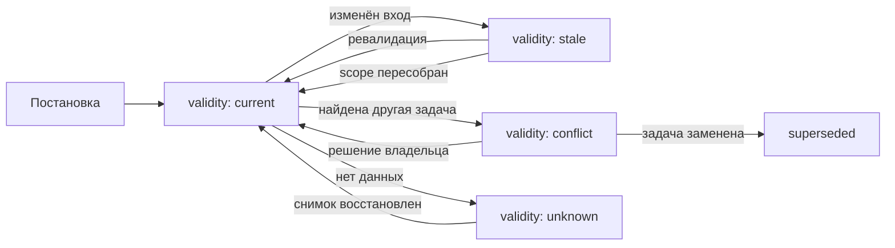

# Контроль актуальности незапущенных задач

> [!warning] Граница документа
> Это design note и результат ресёрча, а не canonical architecture и не описание
> реализованного поведения. Команды `arch task audit …`, `arch task impact …`,
> `arch task revalidate …` и поля `validity` / `invalidated_by` ниже — **предлагаемые**.
> В текущем CLI их нет. Решение фиксируется отдельной задачей и только затем
> переносится в архитектурный контракт и `REG-cli-command-map`.

## 0. Короткий ответ

Проблема не в том, что задачи «стареют по дате». Проблема в том, что у задачи нет
явно смоделированного **входа**: набора артефактов, контрактов и решений, от которых
она зависит. Пока вход не выражен, изменение общего контракта не порождает никакого
сигнала, и незапущенная задача остаётся формально `intake`, хотя её план и критерии
уже не соответствуют дереву.

Рабочая схема состоит из четырёх частей:

1. **Снимок входа** — что именно задача прочитала/предполагала на момент постановки.
2. **Обратная связь «изменение → задача»** — impact по объявленным связям, а не по дате.
3. **Отдельное состояние валидности** (`current` / `stale` / `conflict` / `unknown`),
   не смешанное с `phase`.
4. **Гейт готовности при взятии задачи** — `go-to-task` не начинает планирование,
   пока задача не ревалидирована.

В `data/` все четыре элемента описаны по отдельности; в фабрике уже есть половина
инфраструктуры (`intent_digest`, `expected_revision`, `events.jsonl`, `docs impact`,
`evidence_freshness`, `task workspace`), но нет слоя, который связывает их в контроль
бэклога.

## 1. Постановка проблемы

### 1.1 Сценарий владельца

1. Создаётся задача A. Она опирается на текущий `paths.yaml`, текущий реестр типов
   документов и текущий `task-conf`.
2. Позже создаётся задача B. B меняет `paths.yaml`, `task-conf` или схему.
3. Задача A остаётся в `intake`. Её `acceptance_criteria`, `implementation_plan`,
   `allowed_files_modules` и предположения описывают **прошлое** состояние дерева.
4. При взятии A агент видит валидную по схеме карточку и начинает работу по устаревшему
   плану. Часть работы уже сделана B, часть противоречит B, часть ссылается на
   удалённый тип или переименованное поле.

Ошибка обнаруживается поздно: на этапе реализации или приёмки, когда стоимость
переделки максимальна. При этом формально ни один валидатор не падал: структура
карточки корректна.

### 1.2 Почему это системная проблема, а не небрежность

- **`depends_on` описывает порядок, а не общий вход.** «Сначала B, потом A» и
  «B изменила контракт, на который опиралась A» — разные отношения. Второго в модели нет.
- **Валидация структурная, а не семантическая.** `task validate` проверяет поля и enum,
  но не проверяет, что упомянутый тип/flow/раздел ещё существует и означает то же самое.
- **`phase` перегружен.** Он описывает жизненный цикл, но не отвечает на вопрос
  «можно ли этой карточке доверять сейчас».
- **Бэклог никто не перечитывает.** Между постановкой и исполнением может пройти
  много изменений; повторное чтение всех карточек дорого и не автоматизировано.

### 1.3 Что считается успехом

- Изменение общего контракта **автоматически** помечает затронутые незапущенные задачи.
- Агент перед стартом получает не «карточка валидна», а «карточка валидна относительно
  такого-то снимка; вот что изменилось; вот что нужно перепроверить».
- Конфликт двух незапущенных задач виден **до** начала работы, а не при merge.
- Ни одна задача не переписывается молча: изменение требований — явное решение владельца
  с записью в журнал.

## 2. Что показал аудит текущего корпуса

Проверено по `doc/tasks/UI-*/task.json` на 2026-11-22.

### 2.1 Общая картина

| Показатель | Значение |
|---|---|
| Всего задач | 31 |
| Незавершённых | 15 |
| Из них в `intake` | 13 |
| В `verification` | 2 |
| Незавершённых без `depends_on` | 5 (`UI-0027`…`UI-0031`) |
| Задач с детьми | 12 |

Пять самых новых задач (`UI-0027`…`UI-0031`) заведены без зависимостей, хотя все
они меняют пересекающиеся области: `doc/architecture/`, `doc/config/paths.yaml`,
`doc/config/task-conf/`, `doc/tools/arch/`, `doc/tests/`.

### 2.2 Конкретные конфликты

| Конфликт | Суть | Почему не виден сейчас |
|---|---|---|
| `UI-0030` ↔ `UI-0029` | `UI-0030` мигрирует трёх детей `UI-0029` на предметные типы и меняет `task-conf`; `UI-0029` в `scope.out` прямо запрещает менять `task-conf` | Формально это не `depends_on`; конфликт в scope-политике, а не в порядке |
| `UI-0031` ↔ `UI-0028` | `UI-0031` правит реестр типов и `glossary.json`; `UI-0028` делает глоссарий JSON-каноном | Пересечение по смыслу и по файлам, связь не объявлена |
| `UI-0029` / `UI-0030` / `UI-0031` | Все три трогают `paths.yaml`, `task-conf` или `schemas`, все три — `doc/tests/` | Широкие `allowed_files_modules` дают пересечение, но никто его не считает |
| `UI-0018`…`UI-0025` | Цепочка зависимостей корректна, но часть задач ссылается на контракты, которые меняют более новые задачи | `depends_on` смотрит только назад, на уже созданные карточки |

### 2.3 Ограничение этого аудита

Пересечение выше посчитано по префиксам `allowed_files_modules` и потому шумное:
`doc/architecture/` есть почти у всех. Для реального гейта нужно сравнивать **конкретные
файлы и контракты**, а не каталоги. Это важный вывод для дизайна: грубый scope overlap
даст ложные срабатывания и будет отключён первым.

## 3. Что уже есть в фабрике

### 3.1 Сущности и поля

| Элемент | Где | Что даёт для контроля |
|---|---|---|
| `task.json` | `ENT-task-input` | `intent`, `scope`, `acceptance_criteria`, `related_docs`, `project_context_refs`, `depends_on`, `assumptions`, `open_questions` |
| `intent_digest` | `ENT-task-record` | SHA-256 неизменяемого intent-подмножества; уже позволяет обнаружить подмену входа |
| `state.json` / `events.jsonl` | `ENT-task-record` | Ревизия, append-only журнал, идемпотентные события, replay |
| `verification.json` + `snapshot_files` | `ENT-verification-evidence` | Хеши проверенного снимка; устаревание evidence уже моделируется |
| `flow_version` | `ENT-task-record` | Пин версии flow на момент миграции |
| `allowed_files_modules` | `task.json` | Заявленная граница записи; основа для пересечения |
| `related_docs` / `project_context_refs` | `task.json` | Объявленные входы задачи; основа для impact |

### 3.2 Команды

| Команда | Что уже умеет | Чего не хватает |
|---|---|---|
| `arch task diagnose` | Блокировки, готовность детей, `evidence_freshness`, `acceptance_plan_ready` | Не сравнивает вход задачи с текущим деревом |
| `arch task doctor` | Сводка фазы, блокировок, preflight | Нет валидности входа |
| `arch task workspace` | Пересечение незакоммиченных файлов с `changed_files` | Не сравнивает с другими задачами |
| `arch task evidence --check` | `current` / `stale` / `missing` для evidence | Только evidence, не вход |
| `arch docs impact` | Изменённые разделы и объявленные потребители | Только документы, не задачи |
| `arch docs context --task` | Пакет объявленных ссылок задачи | Нет дельты «снимок постановки → сейчас» |
| `arch scan --scope tasks` | Структурные инциденты корпуса | Нет семантических и кросс-задачных проверок |
| `arch task event` / `migrate` / `replay` | Журнал, ревизии, идемпотентность | Нет типов событий `task.invalidated` / `task.revalidated` |

### 3.3 Вывод по существующей базе

Детерминированная часть почти готова: есть хеши, ревизии, журнал, impact по документам
и модель свежести evidence. Не хватает трёх вещей:

1. **вход задачи как проверяемая сущность** (список артефактов + их хеши/ревизии на момент постановки);
2. **обратного ребра** «изменение артефакта → затронутые задачи»;
3. **состояния валидности** и гейта, который его использует.

## 4. Находки в `data/`

### 4.1 Прямые механизмы

| Механизм | Документ | Что берём |
|---|---|---|
| Свежесть и staleness | [Актуальность и staleness](data/machinedocs-encyclopedia/Практики/Актуальность%20и%20staleness.md) | Устаревание = движение upstream, а не возраст; `lastValidated`, `maxAgeDays`, `upstream_commit`, smart refresh с short-circuit |
| Трассируемость | [Качество и трассируемость](data/sdd-research/06-качество-и-трассируемость.md) | Матрица «требование → дизайн → задача → тест → код», forward/backward trace, ревью между фазами |
| Дельта требований | [Delta Specs](data/sdd-encyclopedia/Сущности/Delta%20Specs.md), [Proposal](data/sdd-encyclopedia/Сущности/Proposal.md), [OpenSpec](data/sdd-encyclopedia/Инструменты/OpenSpec.md) | Изменение описывается относительно базы; конфликт дельт виден до применения |
| Дрейф спек | [История и эволюция SDD](data/sdd-research/07-история-и-эволюция.md) | Static-спеки устаревают; противоядие — verify/analyze/archive и governance |
| Независимость задач | [Параллельная работа агентов](data/machinedocs-encyclopedia/Практики/Параллельная%20работа%20агентов.md) | Признаки не-независимости: общий файл, интерфейс, миграция, lockfile; AC одной зависит от решения другой |
| Контракт и scope | [Контракт задачи для агента](data/machinedocs-encyclopedia/Практики/Контракт%20задачи%20для%20агента.md) | Смена scope — только через issue/approval; план до широких изменений |
| Контекст и свежесть | [Управление контекстом многоагентных систем](data/machinedocs-encyclopedia/Практики/Управление%20контекстом%20многоагентных%20систем.md) | Task context — immutable snapshot; freshness входит в retrieval; stale/contradictory надо отклонять или уточнять; cold resume |
| Lifecycle и `stale input` | [Исследование software factory](data/machinedocs-encyclopedia/Практики/Исследование%20software%20factory%20—%20пробелы%20и%20готовые%20практики.md) | `source update/cancel → приостановка и пересборка scope`; reconciliation; consumer перечитывает задачу перед dispatch |
| Impact и affected set | [Инструменты аудита для software factory](data/machinedocs-encyclopedia/Практики/Инструменты%20аудита%20для%20software%20factory.md) | Dependency graph, affected targets, test impact selection |
| Reference-паттерны | [Готовые решения агентной software factory](data/machinedocs-encyclopedia/Практики/Готовые%20решения%20агентной%20software%20factory.md) | Missions — план до исполнения; Symphony — polling/reconciliation; Performance Factory — durable task state |

### 4.2 Классы практик вне фабрик

| Класс | Аналог | Что переносится |
|---|---|---|
| Requirements management | DOORS / Jama / Polarion | Baseline + change control; при изменении upstream связь становится `suspect` и требует ревью |
| Agile / Kanban | DoR, refinement, WIP-лимиты | Definition of Ready проверяется **в момент взятия**, а не только при создании |
| Incremental build / data lineage | Bazel/Nx affected, dbt source freshness, asset staleness | Задача — узел графа входов; изменился вход → узел stale; пересчитывается только affected set |

### 4.3 Синтез

Общая формула, которую подтверждают все источники:

> Актуальность задачи — это не свойство карточки, а **отношение между снимком её входов
> и текущим состоянием дерева**, плюс отсутствие конфликта с другими незапущенными задачами.

Отсюда следует, что нужен не «аудит вообще», а три конкретные вещи: снимок входа,
impact propagation и гейт готовности.

## 5. Разрыв в текущей модели

### 5.1 Смешение отношений

| Отношение | Смысл | Есть сейчас |
|---|---|---|
| `depends_on` | Порядок исполнения | Да |
| `shares_contract` | Обе задачи читают/меняют один артефакт | Нет (только как шумный scope overlap) |
| `invalidates` / `invalidated_by` | Новая задача меняет вход старой | Нет |
| `conflicts_with` | Взаимоисключающие решения или пересечение записи | Нет |
| `supersedes` / `duplicate_of` | Задача заменена или дублирует другую | Нет |

`depends_on` не подходит на роль обратного ребра: он блокирует **закрытие** и задаёт
порядок, а нам нужно **пометить** задачу как требующую перепроверки, не блокируя
чужие работы каскадом.

### 5.2 Нет входов как сущности

`related_docs` и `project_context_refs` — это ссылки, но не снимок. Не сохраняется,
какие хеши/ревизии/версии конфигов были актуальны при постановке. Без этого нельзя
ответить «что изменилось с момента постановки» — можно только перечитать всё заново.

### 5.3 Нет валидности как состояния

`phase` отвечает на «где задача в lifecycle». `evidence_freshness` — на «свежи ли
доказательства». Вопроса «можно ли доверять карточке прямо сейчас» не задаёт никто.

### 5.4 Нет гейта

`create-task` заканчивается предложением приступить. `go-to-task` проверяет
`diagnose`, `workspace` и план, но не проверяет, что вход задачи всё ещё актуален.
Поэтому устаревшая карточка проходит все проверки.

## 6. Предлагаемая модель

### 6.1 Классы устаревания

Без причины «stale» агенту бесполезен. Предлагается закрытый набор:

| Класс | Что означает | Источник сигнала |
|---|---|---|
| `source-stale` | Изменился внешний тикет/сообщение владельца | `source.revision` / `captured_at` против текущего источника |
| `contract-stale` | Изменился документ, схема или конфиг, на который ссылалась задача | Хеши `related_docs` / `project_context_refs` / `paths.yaml` / `task-conf` |
| `dependency-stale` | Зависимость изменила scope, AC или phase | Сравнение карточки зависимости со снимком |
| `conflict` | Другая незапущенная задача трогает тот же артефакт или противоречит решению | `shares_contract` + семантическое ревью |
| `superseded` | Результат уже достигнут другой задачей или подход заменён | Семантическое ревью + `supersedes` |
| `schema-stale` | Тип, flow или поле задачи больше не существуют или переименованы | `task types`, `task flows`, `scan --scope task-conf` |
| `environment-stale` | Baseline больше не воспроизводится | `task baseline`, `evidence --check` |

### 6.2 Снимок входа

Предлагается хранить отдельным артефактом, чтобы не раздувать канонический `task.json`:

```json
{
  "task_key": "UI-0029",
  "captured_at": "2026-11-22T18:00:00Z",
  "commit": "0123456789abcdef",
  "inputs": [
    {"kind": "doc", "ref": "ARCH-contract", "sha256": "…"},
    {"kind": "config", "ref": "doc/config/paths.yaml", "sha256": "…"},
    {"kind": "task-conf", "ref": "task-conf/types/subtask", "sha256": "…"},
    {"kind": "task", "ref": "UI-0030", "phase": "intake", "intent_digest": "…"}
  ],
  "assumptions_digest": "…"
}
```

Правила:

- снимок создаётся при постановке и обновляется только явной ревалидацией;
- хеши считаются по объявленным входам, а не по всему репозиторию;
- отсутствующий вход — `unknown`, а не «совпал»;
- снимок не заменяет `intent_digest`: intent защищает от подмены карточки,
  снимок — от изменения окружения.

### 6.3 Состояние валидности

```json
"validity": {
  "state": "current | stale | conflict | unknown",
  "classes": ["contract-stale"],
  "last_validated": "2026-11-22",
  "validated_against": {"commit": "…", "snapshot": "stage1/inputs.json"},
  "invalidated_by": ["UI-0030"],
  "findings": []
}
```

`validity` — производное и изменяемое, поэтому ему место в `state.json` (версионированная
запись), а не в `intent_digest`. Для legacy-задач без миграции допустим отдельный
`revalidation.json` рядом с карточкой.

### 6.4 События

Добавить в существующий журнал два типа:

- `task.invalidated` — с причиной, классом, `invalidated_by` и снимком;
- `task.revalidated` — с новым снимком, решением владельца и списком изменённых полей.

Это даёт audit trail и исключает «тихое» переписывание требований: изменение AC
всегда видно как событие, а не как правка файла.

### 6.5 Жизненный цикл валидности



Важно: `stale` **не блокирует** другие задачи и не меняет `phase`. Он блокирует только
переход этой задачи к планированию/реализации до ревалидации.

## 7. Инструменты

### 7.1 CLI (предлагаемое)

| Команда | Назначение | Детерминированная часть |
|---|---|---|
| `arch task snapshot <key>` | Записать снимок входов | Хеши объявленных артефактов, commit, отсутствующие входы |
| `arch task audit <key> [--json]` | Проверить одну задачу | Сравнение снимка с текущим деревом, классы staleness, ссылки, enum типов/flow |
| `arch task audit --all --phase intake,verification [--brief]` | Обойти незапущенные | Affected set по изменённым артефактам, пересечение конкретных файлов |
| `arch task impact <key> [--json]` | Обратное ребро | Какие незапущенные задачи затронет изменение этой задачи |
| `arch task revalidate <key> [--accept-findings]` | Обновить снимок после решения владельца | Новая ревизия, событие `task.revalidated` |
| `arch task graph --phase intake [--json]` | Граф связей | `depends_on`, `shares_contract`, `invalidates`, `conflicts_with` |

Все команды read-only по умолчанию; запись — только `snapshot` и `revalidate`, с
`--dry-run` и атомарной заменой, как у существующих операций.

### 7.2 Формат finding

Агент должен уметь действовать по finding без дополнительного расследования:

```json
{
  "kind": "contract-stale",
  "severity": "blocking",
  "task": "UI-0029",
  "changed_artifact": "doc/config/task-conf/types/subtask/config.yaml",
  "affected_fields": ["acceptance_criteria", "implementation_plan"],
  "evidence": "subtask_policy changed; children of UI-0029 use task_type=subtask",
  "recommended_action": "re-read type policy, re-plan children, confirm with owner",
  "requires_owner": true
}
```

Поля обязательны: `kind`, `severity`, `task`, `evidence`, `recommended_action`.
`severity`: `blocking` (нельзя начинать), `warning` (можно начинать после явного
подтверждения), `info` (зафиксировать в плане).

### 7.3 Разделение CLI и агента

| Слой | Что делает | Что не делает |
|---|---|---|
| CLI | Хеши, ревизии, битые ссылки, циклы, enum, пересечение конкретных файлов, affected set | Не решает, противоречат ли два AC |
| Агент | Семантическое противоречие, дублирование intent, «уже покрыто другой задачей», «план опирался на удалённый тип» | Не переписывает AC и scope без владельца |
| Владелец | Обновить, разделить, объединить, supersede, отменить | — |

Это соответствует уже принятому разделению в фабрике: CLI проверяет структуру,
агент — смысл, владелец — контракт.

### 7.4 Скилл

Предлагается отдельный скилл `audit-tasks` (или `revalidate-tasks`) с двумя режимами:

- `--task <key>` — перед взятием задачи;
- `--all` — периодический обход незапущенных.

Скилл не реализует проверки сам, а вызывает CLI и интерпретирует findings. Это
сохраняет правило «детерминированное — в CLI, смысловое — в скилле».

## 8. Встраивание в существующие флоу

| Точка | Что добавляется |
|---|---|
| `create-task`, шаг 5 | `arch task audit --all --brief`: не конфликтует ли новая карточка с существующими; найти `shares_contract` и предложить `depends_on`/`conflicts_with` |
| `create-task`, завершение | `arch task snapshot <key>` — зафиксировать вход |
| `go-to-task`, шаг 1 | Гейт: `validity != current` → остановка, показать findings, предложить ревалидацию |
| `go-to-task`, шаг 4 | `task workspace` дополнить пересечением с другими незапущенными задачами |
| `task close` | Не блокировать по чужой валидности; обновить снимки затронутых задач через impact |
| `docs impact` | Добавить обратный проход «изменённый раздел → задачи, объявившие его входом» |
| Периодически / перед релизом | `arch task audit --all --phase intake,verification` как `audit`-задача |
| После merge задачи, меняющей контракт | Автоматически пометить затронутые незапущенные задачи `needs-revalidation` |

## 9. Уровни внедрения

| Уровень | Что делаем | Что получаем | Цена |
|---|---|---|---|
| **L0** | Только скилл-чеклист и отчёт без изменения схемы | Быстро, ничего не ломает | Нет автоматики, легко забыть |
| **L1** | `task snapshot` + `task audit` с детерминированными проверками + скилл для семантики | Ловит реальные конфликты корпуса уже сейчас | Нужны объявленные входы и хеши |
| **L2** | Impact propagation + `validity` в `state.json` + обязательный гейт в `go-to-task` + события | Полный цикл «изменил контракт → пометил задачи → ревалидировал» | Больше метаданных и цена поддержки |

Рекомендация: начать с **L1**. Корпус уже показывает конфликты, которые ловятся
детерминированно, без LLM. Семантические противоречия добавить вторым проходом, когда
появятся ложные срабатывания и станет понятна цена.

### 9.1 Приёмочные критерии для L1

1. `task audit` на текущем корпусе находит конфликт `UI-0030` ↔ `UI-0029` и
   пересечение `UI-0031` ↔ `UI-0028`, не помечая при этом весь корпус как `stale`.
2. `task audit` не даёт ложных срабатываний на задачах с корректной цепочкой
   `depends_on` (`UI-0018`…`UI-0025`).
3. Отсутствующий вход даёт `unknown`, а не `current`.
4. `--brief` показывает счётчики и ссылки; полный вывод доступен по запросу.
5. Все команды read-only, кроме `snapshot`/`revalidate`; повторный запуск идемпотентен.
6. Тест на чистой fixture: изменение `paths.yaml` помечает задачу `contract-stale`,
   повторная ревалидация возвращает `current`.

### 9.2 Приёмочные критерии для L2

1. `go-to-task` не начинает планирование при `validity: stale|conflict`.
2. `docs impact` возвращает задачи, объявившие изменённый раздел входом.
3. `task event` поддерживает `task.invalidated` / `task.revalidated` с ревизией и
   идемпотентностью.
4. Старые задачи без `validity` читаются как раньше и получают `unknown`, а не ошибку.
5. Ревалидация не переписывает AC/scope автоматически: только снимок и событие.

## 10. Риски и ограничения

| Риск | Почему опасен | Смягчение |
|---|---|---|
| Метаданные гниют | Формально заполненные `related_docs` дают ложный impact | Производные связи из фактических ссылок и хешей, а не только ручные |
| Широкие пути шумят | `doc/architecture/` есть у всех | Сравнивать конкретные файлы и контракты, не префиксы каталогов |
| Дорогая ревалидация | Полный перечит бэклога на каждое изменение | Affected set + порог по риску, а не полный обход |
| Автопереписывание | Агент «улучшит» AC по своему усмотрению | Только пометка и предложение; изменение — решение владельца |
| Дата как истина | `lastValidated` ничего не доказывает | Сильнее — изменившийся upstream; дата только сигнал |
| Путаница с `depends_on` | Каскадные блокировки остановят фабрику | Разные отношения, разные последствия |
| Дублирование с evidence | Два похожих состояния свежести | `evidence_freshness` — про проверки, `validity` — про вход; не смешивать |
| Раздувание `task.json` | Канонический вход перестанет быть неизменяемым | Снимок и `validity` — отдельно от intent |

### 10.1 Что не делать

- Не помещать `validity` в `phase`: это разные оси.
- Не делать `depends_on` двунаправленным.
- Не считать `unknown` успехом.
- Не блокировать закрытие задачи из-за чужой валидности.
- Не вводить полноценную БД или графовую СУБД: текущего объёма (31 задача) хватает
  файлам и JSON.
- Не переносить `data/` в проект как рабочий файл: это справочник, а не контракт.

## 11. Открытые вопросы

1. **Скилл или гейт?** Рекомендация — и то, и другое: скилл для аудита, гейт в
   `go-to-task`. Без гейта аудит останется необязательной практикой.
2. **Где хранить валидность?** Отдельный `revalidation.json` + события (меньше ломает
   `task.json`) или поля в `state.json` (проще читать). Для legacy нужен оба пути.
3. **Насколько агрессивно ловить семантику?** Сначала только declared/derived связи и
   структурные проверки; LLM-ревью — вторым проходом, с подтверждением человеком.
4. **Кто владелец ревалидации?** Владелец задачи, владелец домена или координатор
   фабрики — зависит от риска. Для `high`/`critical` — владелец, для `low` — агент с
   записью в журнал.
5. **Как быть с задачами без `depends_on`?** Пять новых задач уже показывают проблему.
   Нужно ли требовать явные связи при постановке или выводить их автоматически?
6. **Нужен ли `conflicts_with` как отдельное поле** или достаточно finding + решение
   владельца без хранения?
7. **Что считать «изменением контракта»?** Любая правка раздела, изменение хеша или
   только изменения в объявленных «контрактных» разделах?

## 12. Следующий шаг

1. Обсудить и зафиксировать модель: отношения, классы staleness, место `validity`.
2. Поставить задачу типа `planning` / `research-first` на проработку `task audit` L1
   с приёмочными критериями из §9.1.
3. Реализовать `task snapshot` + `task audit` на текущем корпусе и проверить на
   конфликтах `UI-0029` / `UI-0030` / `UI-0031`.
4. Только после этого добавлять гейт в `go-to-task` и события в журнал.

## 13. Связи

- [Корневой манифест](Манифест%20агентной%20software%20factory.md) · [План развития](nextplan.md) · [Worktrees и релизная интеграция](worktree.md)
- `ENT-task-input` · `ENT-task-record` · `ENT-verification-evidence` · `FLOW-create-task` · `FLOW-execute-task` · `CAP-addressable-contracts` · `REG-cli-command-map`
- [Актуальность и staleness](data/machinedocs-encyclopedia/Практики/Актуальность%20и%20staleness.md) · [Качество и трассируемость](data/sdd-research/06-качество-и-трассируемость.md) · [Delta Specs](data/sdd-encyclopedia/Сущности/Delta%20Specs.md) · [Параллельная работа агентов](data/machinedocs-encyclopedia/Практики/Параллельная%20работа%20агентов.md) · [Управление контекстом многоагентных систем](data/machinedocs-encyclopedia/Практики/Управление%20контекстом%20многоагентных%20систем.md) · [Исследование software factory](data/machinedocs-encyclopedia/Практики/Исследование%20software%20factory%20—%20пробелы%20и%20готовые%20практики.md)
