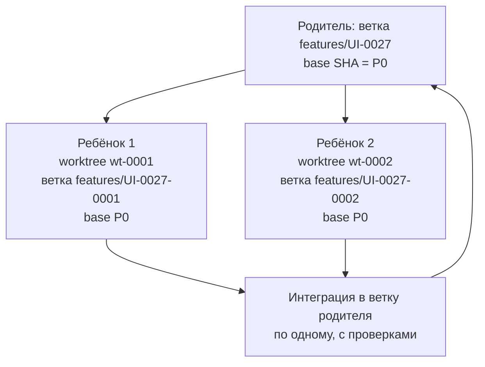
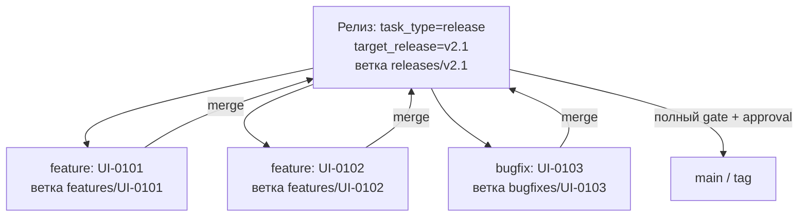

# Worktrees, дочерние задачи и релизная интеграция

> [!warning] Граница документа
> Это design note, а не canonical architecture и не описание уже реализованного поведения.
> Решения по Git-процессу фиксируются в [UI-0027](doc/tasks/UI-0027/task.json) и в
> [architecture](doc/architecture/system/manifest.md). Команды `task git …` ниже —
> **предлагаемые** имена из плана UI-0027; в текущем CLI их нет. `task workspace` пока
> только читает карточку. Не выдавайте этот документ за работающий runtime.

## 0. Короткий ответ

Да, обе среды умеют изолировать работу в git worktree, но примитивы разные:

- **Kilo Code**: `task`-субагент **не** создаёт worktree и не меняет каталог — он работает в
  каталоге родителя. Изоляцию даёт **Agent Manager** (режим `worktree`), и это отдельная
  top-level сессия, а не дочерний `task`.
- **OpenCode v2**: worktree — встроенный примитив (`worktree_create` / `worktree_list` /
  `worktree_remove`) плюс `session_move`. Субагент по умолчанию наследует каталог родителя;
  per-subagent worktree нативно нет (есть открытый PR и сторонний плагин).
- **Ни то, ни другое не sandbox безопасности.** Worktree изолирует файлы и git-состояние, но
  не процессы, сеть, порты, Docker, кэши и credentials.

Отсюда два рабочих паттерна, которые не конфликтуют, а складываются:

| Паттерн | Что делает | Кто владеет интеграцией |
|---|---|---|
| **A. Дети в worktree родителя** | ребёнок получает свою ветку от SHA родителя, коммитит в неё, родитель вливает обратно | родитель |
| **B. Релиз как родительская задача** | релиз — контейнер, дети — слайсы; публикация и мерж только на релизе | релизная задача |

Ключевое ограничение фабрики: UI-0027 (AC-5) фиксирует, что **по умолчанию ребёнок работает
в ветке родителя без собственного коммита и push**, а отдельный режим (ветка от SHA родителя)
пока только контракт, не реализация. Значит параллельная запись детей через фабрику станет
штатной только после реализации этого режима; до тех пор параллелизм делается средствами
среды (Agent Manager / `worktree_create`) и остаётся вне контракта задачи.

---

## 1. Термины

| Термин | Смысл в этом документе |
|---|---|
| **Задача-родитель** | `task.json` верхнего уровня: `feature`, `release` или иной контейнер. |
| **Ребёнок** | Либо `subtasks[]` (лист, без дальнейшей декомпозиции), либо отдельная задача-слайс. |
| **Worktree** | Отдельный checkout того же репозитория на своей ветке/HEAD; общий `.git` object store. |
| **База (base SHA)** | Коммит, от которого создана ветка; фиксируется в плане и evidence. |
| **Ветка родителя** | Ветка, куда интегрируются дети; для релиза — релизная ветка. |
| **Публикация** | `commit` + `push` в разрешённый ref после подтверждения точного снимка. |
| **Интеграция** | `merge`/PR согласованного результата в цель (ветку родителя, релизную или main). |
| **Dirty worktree** | staged/unstaged/untracked правки; политика `ask` / `block` / `separate_worktree`. |

---

## 2. Что реально умеют среды

Сверено с документацией Kilo Code и OpenCode v2 (ноябрь 2026) и с энциклопедией
[`data/subagents-encyclopedia`](data/subagents-encyclopedia/Главная.md).

### 2.1 Kilo Code

| Возможность | Есть | Детали |
|---|---|---|
| `task`-субагент | да | foreground/background, своё окно контекста, **каталог родителя**. |
| Смена каталога у `task` | нет | параметра нет; worktree для `task` не создаётся. |
| Agent Manager worktree | да | отдельная сессия на worktree, ветку, терминал; `.kilo/worktrees/`. |
| Запуск из чата | да, VS Code | инструмент `agent_manager`, `mode: "worktree"`, до 20 задач за вызов. |
| Из CLI/TUI | нет | `agent_manager` — фича расширения VS Code, не CLI. |
| Setup/run скрипты | да | `.kilo/setup-script`, `.kilo/run-script`; `WORKTREE_PATH`, `REPO_PATH`. |
| Общая доска | да | Kilo Swarm в пределах дерева одной сессии; разные Agent Manager сессии её не делят. |

Важно: `agent_manager` требует явного запроса пользователя и собственного permission.
Скилл может описать последовательность, но не может выдать себе это разрешение.

### 2.2 OpenCode v2

| Возможность | Есть | Детали |
|---|---|---|
| `worktree_create` | да | создаёт worktree, возвращает `directory`; стратегию задаёт конфиг проекта. |
| Ветка при создании | нет | worktree создаётся **detached** от HEAD; ветку создаёт агент. |
| `session_move` | да | переносит сессию в каталог; применяется на безопасной границе вызова. |
| `worktree_remove` | да | требует `edit` permission; `force` отбрасывает uncommitted. |
| `opencode run -w` | да | `--worktree=name`; worktree остаётся после прогона; несовместим с `--continue`/`--session`. |
| Setup при создании | да | проектный `commands.start`. |
| Субагент в своём worktree | нет (нативно) | наследует каталог родителя; есть открытый PR и плагин `KelpHect/opencode-worktrees`. |
| Sandbox | нет | только `permissions`; `shell` работает с правами хоста. |
| Клиенты | CLI, web (`opencode pair`), desktop | один background server; worktree создаётся на диске сервера. |

### 2.3 Матрица «кто в каком каталоге»

| Сценарий | Kilo Code | OpenCode v2 |
|---|---|---|
| Обычный `task`/`subagent` | каталог родителя | каталог родителя |
| Изолированная top-level сессия | Agent Manager `worktree` | `worktree_create` + `session_move` |
| Headless в новом worktree | — | `opencode run -w=name` |
| Per-subagent worktree | нет | нет нативно (плагин/PR) |
| Ветка создаётся автоматически | да (Agent Manager) | нет (detached) |
| Ограничение доступа | permissions | permissions |

### 2.4 Чего нет ни там, ни там

- OS-level sandbox и сетевой firewall для агентских команд.
- Автоматической семантической независимости: два worktree всё равно конфликтуют при merge.
- Изоляции внешних ресурсов: порт, БД, Docker volume, кэш пакетов — общие, если не разведены
  через env/`COMPOSE_PROJECT_NAME`/`WORKTREE_PATH`.
- Безопасного `git stash` между worktree: stash живёт в общем `.git` и «протекает» между копиями.

---

## 3. Паттерн A: дети выполняют части родителя в worktree и коммитят в него

### 3.1 Когда применять

- Слайсы **независимы** по файлам и контрактам, у каждого один проверяемый outcome.
- Родитель уже зафиксировал общий интерфейс/схему/раскладку, чтобы дети не разошлись.
- Есть ёмкость на ревью и интеграцию: практический предел — 2–4 параллельных агента.

Не применять, если слайсы меняют один API, миграцию, lockfile, центральный конфиг или общий
компонент. Сначала согласовать контракт последовательно, потом параллелить.

### 3.2 Топология



Правила:

1. Все дети стартуют от **одного известного SHA** родителя и чистого состояния.
2. У каждого ребёнка свой worktree и своя ветка; общие файлы заранее назначены одному владельцу.
3. Ребёнок коммитит **в свою ветку**, не в ветку родителя и не в основную.
4. Ребёнок **не публикует** сам: push/merge — решение родителя (по умолчанию).
5. Интеграция — по одному ребёнку, после каждого шага проверки на итоговом дереве.
6. Конфликт разрешается в интеграционной ветке после остановки параллельного редактирования.

### 3.3 Flow

```text
prepare parent     → ветка родителя, base SHA, политика dirty tree
dispatch child N   → worktree + ветка от base SHA + task envelope
implement child N  → правки, целевые проверки, локальный коммит
report child N     → путь, ветка, SHA, изменённые файлы, результаты проверок
integrate child N  → merge в ветку родителя, проверки на combined tree
cleanup            → удалить worktree, если коммит влит; иначе сохранить и записать остаток
```

### 3.4 Kilo Code: конкретные вызовы

Из VS Code, после явного разрешения пользователя:

```json
{
  "mode": "worktree",
  "versions": false,
  "tasks": [
    {
      "name": "UI-0027/0001",
      "branchName": "features/UI-0027-0001",
      "baseBranch": "features/UI-0027",
      "prompt": "Task envelope: objective, allowed paths, acceptance, checks. Commit only to this branch. Do not push or merge."
    }
  ]
}
```

Далее `action: "list"` → `action: "prompt"` с `sessionID` для итераций. Каждая сессия получает
свой worktree, ветку и терминал. Setup-скрипт готовит окружение, run-скрипт поднимает проект.

Ограничения:

- Это **не** `task`-субагент: контекст родителя не наследуется, его надо передать в `prompt`.
- Swarm-борд родителя с этими сессиями не общий; координация — через файлы, коммиты, diff.
- В CLI/TUI этого пути нет: остаётся ручной `git worktree add` и обычный `task` в каталоге родителя.

### 3.5 OpenCode v2: конкретные вызовы

```text
1. worktree_create name "UI-0027-0001"        → directory
2. shell: git -C <directory> checkout -b features/UI-0027-0001
3. session_move → <directory>
4. shell: pwd; git rev-parse --show-toplevel; git rev-parse HEAD
5. subagent (general) с task envelope
6. shell: git add <files> && git commit -m "<message>"
7. родитель: git -C <main-checkout> merge --no-ff features/UI-0027-0001
```

Критично: `worktree_create` даёт **detached HEAD**. Без шага 2 коммит не попадёт в ветку.
После `session_move` проверьте каталог следующим вызовом — move применяется на границе.
Headless-вариант: `opencode run -w=UI-0027-0001 "…"`, но ветку всё равно создавать вручную.

Скилл здесь только описывает шаги; исполнение ограничено `permissions` (`subagent`, `edit`,
`shell`). В headless без `--auto` или заранее разрешённых правил вызов может встать на approval.

### 3.6 Что считать «закоммитить в него»

Коммит всегда попадает в **ветку worktree**, а не в «родительский worktree». «Влить в родителя»
означает отдельный `merge`/PR в ветку родителя. Если хочется, чтобы правки ребёнка выглядели
как один коммит родителя, используйте squash при интеграции — но это меняет SHA и должно быть
зафиксировано в evidence.

### 3.7 Ограничения и риски

- Worktree — не sandbox: недоверенный код видит сеть и общие сервисы.
- Кэши, порты, БД и Docker общие; разводите через env, иначе параллельные прогоны конфликтуют.
- `git stash` запрещён: stash общий для всех worktree.
- Не делать `reset`, `rebase`, `force-push` и автоматический `checkout` поверх чужих правок.
- После интеграции удалять worktree; невлитые остатки фиксировать, а не «подчищать» молча.

---

## 4. Паттерн B: релиз всегда родительская задача

### 4.1 Модель

Релиз — не ещё один слайс, а **контейнер и владелец интеграции**. Дети реализуют изменения,
релиз отвечает за то, чтобы они сошлись вместе, прошли полный gate и попали в релизную ветку.



### 4.2 Почему релиз — родитель

- У релиза уже есть естественный якорь: `target_release` и mapping release → branch в проектном
  конфиге ([manifest](doc/architecture/system/manifest.md), §13 «Release target и ветка»).
- Только релиз знает полный набор изменений и может прогнать combined CI на итоговом дереве.
- Публикация и мерж — ровно те действия, которые нельзя раздавать каждому ребёнку.
- Evidence привязано к SHA; релиз собирает evidence детей в один проверяемый пакет.

### 4.3 Правила

1. Релиз — задача верхнего уровня типа `release` (предложение; сейчас такого типа нет).
2. `target_release` обязателен; `unset` или неизвестный релиз — ошибка, не угадывание.
3. Ветка релиза — `releases/<target_release>`; дети ветвятся от её HEAD SHA.
4. Ребёнок коммитит в свою ветку. Публикация ребёнка — только если политика типа разрешает;
   мерж в релизную ветку — **только** релиз.
5. Релиз вливает детей по одному, в порядке `depends_on`; после каждого мержа — проверки.
6. Полный gate и финальный merge в `main`/tag — только после закрытия всех детей.
7. Закрытие ребёнка не заменяет одобрение публикации; конфиг не выдаёт согласие.
8. Релиз не считается закрытым, пока не закрыты все дети и не записан итоговый evidence.

### 4.4 Как параллелить

| Ситуация | Что делать |
|---|---|
| Слайсы не пересекаются | отдельные worktree и ветки от одного SHA релиза, параллельно |
| Общий контракт | сначала последовательно зафиксировать контракт в релизной ветке |
| Слайс зависит от другого | `depends_on`; старт после мержа зависимости, база — новый HEAD релиза |
| Релизная ветка ушла вперёд | остальные дети вливают базу в себя (`merge`, не `rebase`), затем перепроверка |
| Конфликт | разрешать в ребёнке или в интеграционной ветке, не в чужом активном worktree |

Ограничение по ёмкости: 2–4 параллельных агента; предел задаёт стоимость ревью и интеграции,
а не память. Дети в одном worktree при write-heavy работе конфликтуют.

### 4.5 Конфиг (предложение)

Проектный конфиг — remote, main, релизы, dirty tree. Конфиг типа — шаблоны и политика.

```yaml
# doc/config/ (проект)
git:
  remote: origin
  main_branch: main
  release_branches:
    v2.1: releases/v2.1
  dirty_worktree: ask          # ask | block | separate_worktree
  fetch_on_prepare: true
```

```yaml
# doc/config/task-conf/types/release/config.yaml (предложение)
id: release
title: Релиз
subtask_policy: required
close_policy: all_subtasks_required
required_fields:
  - rollback_plan
  - acceptance_criteria
  - implementation_plan
  - target_release
git:
  branch_template: "releases/{target_release}"
  commit_template: "release: {target_release} {summary}"
  publish: release_branch        # none | task_branch | release_branch
  merge: into_main_after_children
children:
  default_branch_mode: inherit   # inherit | separate
  parallel: allowed_with_separate_mode
```

Имена полей — предложение. Реальные имена стабилизируются в UI-0027 и карте CLI.

### 4.6 Интеграция и публикация

- **Preview** показывает цель (main или релизная ветка), список файлов, сообщение, ожидаемый SHA
  назначения и удалённые эффекты. Preview ничего не пишет.
- **Confirm** привязан к preview id и проверенному снимку. Изменение файла, списка файлов или
  целевого SHA инвалидирует подтверждение.
- Коммит и push — один пакет согласования, но не атомарная операция. Сбой push повторяется
  тем же коммитом; второго коммита не создаётся.
- Интеграция по умолчанию выключена. При включении требует охватывающего подтверждения и
  тестов именно интегрируемого результата.
- Устаревший снимок результата не мержится: сначала повторная проверка, потом интеграция.

---

## 5. Как совмещать A и B

Трёхуровневая схема, если она нужна:

```text
release (контейнер, владеет релизной веткой)
  └─ feature-задача (слайс, владеет своей веткой и своими subtasks)
       └─ subtask (лист, по умолчанию в ветке feature, без своего ref)
```

Правила совмещения:

1. `subtask` остаётся листом: дальнейшая декомпозиция запрещена конфигом типа.
2. Если слайсу нужны свои подзадачи — это отдельная задача (`feature`/`bugfix`), а не subtask.
3. Ветка наследуется вниз: release → feature → subtask.
4. Отдельный worktree/ветка — только там, где нужен параллелизм, и только по явной политике.
5. Публикация — на самом верхнем уровне, который её разрешает; по умолчанию — только релиз.

### 5.1 Таблица решений

| Хочу | Паттерн | Механизм | Статус |
|---|---|---|---|
| Дети просто дописывают родителя | A-default | ветка/worktree родителя, без своего ref | контракт UI-0027 AC-5 |
| Дети пишут параллельно | A-separate | ветка от SHA родителя, мерж только в родителя | контракт, реализация отложена |
| Параллельно уже сейчас | env-level | Kilo Agent Manager / OpenCode `worktree_create` | есть в средах |
| Релиз собирает всё | B | тип `release`, релизная ветка, мерж только релизом | предложение |
| Только исследование | — | read-heavy в одном worktree | безопасно всегда |

---

## 6. Сверка с UI-0027

| AC | Что требует | Как отражено здесь |
|---|---|---|
| AC-1 | шаблоны и цели из конфига, ошибка до Git-записи | §4.5, §3.3 prepare |
| AC-2 | подготовка ветки, путь/base SHA/политика, `ask`/`block`/`separate_worktree` | §3.2, §3.3, §3.6 |
| AC-3 | публикация только после подтверждения снимка, повтор без второго коммита | §4.6 |
| AC-4 | интеграция off по умолчанию, цель и удалённые эффекты | §4.6, §4.3 |
| AC-5 | ребёнок по умолчанию в ветке родителя, отдельный режим — только контракт | §0, §3.2, §5 |

Что **не** входит в UI-0027: реализация отдельной дочерней ветки, интеграция с Kilo/другим
вендором, Git-hosted автоматизация, деплой, подключение реального remote. Этот документ их
описывает как возможности сред и как будущий контракт, но не как сделанную работу.

---

## 7. Инварианты и безопасность

1. **Единственный вход — `task.json`.** Worktree, ветка и база — производные, а не новая истина.
2. **`task workspace` остаётся read-only.** Подготовка — отдельная команда.
3. **Ни один переход не сбрасывает, не прячет и не переносит чужие правки.**
4. **Нет `reset`, `stash`, `force-push`, автоматического `rebase` и `checkout` поверх грязного дерева.**
5. **Dirty tree:** `ask` возвращает варианты без записи; `block` отказывает; `separate_worktree`
   создаёт копию, не перенося правки; занятая ветка и незавершённый merge/rebase не обходятся.
6. **Approval привязан к снимку:** файлы, сообщение, назначение, base SHA. Снимок изменился —
   согласование недействительно.
7. **Least privilege:** субагенту только нужные инструменты; read-only ревьюеру — без `shell`.
8. **Evidence на стабильном снимке:** `arch task evidence --check`; повторный прогон — после
   изменения кода, данных или окружения.
9. **Лимит параллелизма** — по ёмкости ревью, а не по числу доступных агентов.
10. **Чистка:** worktree удаляется после интеграции; невлитые остатки фиксируются явно.

---

## 8. Лучшие практики из `data/` (сверка)

| Источник | Что берём |
|---|---|
| [Изоляция и worktrees](data/subagents-encyclopedia/Паттерны/Изоляция%20и%20worktrees.md) | Уровни КФПД: контекст, файлы, память, доступ. Worktree = уровень «файлы», не sandbox. |
| [Параллельная работа агентов](data/machinedocs-encyclopedia/Практики/Параллельная%20работа%20агентов.md) | Правила 1–8: один SHA, один outcome, свой worktree/ветка, интеграция по одному, лимит по ёмкости ревью. |
| [Паттерны оркестрации](data/subagents-encyclopedia/Паттерны/Паттерны%20оркестрации.md) | Зависимости → sequential/pipeline; независимые → parallel; синтез у родителя. |
| [Контекст и handoff](data/subagents-encyclopedia/Паттерны/Контекст%20и%20handoff.md) | Compact handoff, единый формат вывода, selective sharing, synthesis at parent. |
| [Контракт задачи для агента](data/machinedocs-encyclopedia/Практики/Контракт%20задачи%20для%20агента.md) | Одно ядро изменения, наблюдаемые AC, явные границы и authority. |
| [Уровни автономии](data/machinedocs-encyclopedia/Практики/Уровни%20автономии.md) | Публикация и мерж — высокий уровень автономии, требует отдельного одобрения. |
| [Kilo Code](data/subagents-encyclopedia/Среды/Kilo%20Code.md) | Agent Manager, worktrees, Swarm; ошибка — write-heavy агенты в одном worktree. |
| [OpenCode](data/subagents-encyclopedia/Среды/OpenCode.md) | Primary/subagent, лимит глубины 2, 2–4 параллельных агента, allowlist субагентов. |

Итог сверки: предложенная схема совпадает с энциклопедиями — изоляция файлов через worktree,
последовательная интеграция, синтез и публикация у родителя, лимит параллелизма по ревью.

---

## 9. Анти-паттерны

- Дать `task`-субагенту «worktree», которого у него нет, и ждать изоляции.
- Коммитить в detached HEAD OpenCode и потерять результат.
- Запускать write-heavy детей в одном worktree «для скорости».
- Публиковать из каждого ребёнка и потом разбирать расхождения веток.
- `git stash` для переноса правок между worktree.
- Считать worktree песочницей для недоверенного кода.
- Мержить устаревший снимок без повторной проверки.
- Автоматически обходить занятую ветку или незавершённый merge/rebase.
- Разрешать параллелизм без зафиксированного общего контракта.

---

## 10. Артефакты для реализации (предложение)

| Артефакт | Назначение | Статус |
|---|---|---|
| `git-workflow` skill | клиентонезависимый порядок prepare → publish → integrate | план UI-0027/0002 |
| `worktree-dispatch` skill/command | envelope ребёнка, выбор default/separate, сбор отчёта | предложение |
| `task git prepare` | валидация политики, подготовка ветки/worktree, base SHA | предложение |
| `task git publish --preview/--confirm` | подтверждаемый commit + push по снимку | предложение |
| `task git integrate` | предпросмотр и мерж в согласованную цель | предложение |
| тип `release` | контейнер, релизная ветка, публикация только релизом | предложение |
| поля `git` в конфигах | шаблоны ветки/коммита, publish/merge, dirty tree | предложение |

Существующее и не подлежащее расширению в этом срезе: `task workspace` (read-only),
`task evidence`, `task close`, `go-to-task` как точка входа.

---

## 11. Открытые вопросы

1. **Тип `release` vs отдельная сущность.** Делать релиз задачей типа `release` или отдельным
   реестром релизов со ссылками на задачи? Влияет на `close_policy` и evidence.
2. **Дети релиза: subtasks или отдельные задачи.** Subtask запрещает декомпозицию; если слайсу
   нужны свои подзадачи, он должен быть отдельной задачей. Нужен явный контракт связи.
3. **Где живёт ветка ребёнка.** В том же репозитории (worktree) или отдельный клон? Влияет на
   кэши, порты и стоимость диска.
4. **Политика публикации ребёнка.** Пуш своей ветки для backup/PR или полностью локальная работа
   до мержа родителем?
5. **Обновление базы.** `merge` базы в ребёнка (безопасно, но создаёт merge-коммиты) или
   пересоздание ветки от нового SHA (чище, но теряет историю)?
6. **Предел параллелизма** для конкретного проекта и стоимость ревью.
7. **Кто владеет чисткой worktree** после интеграции: CLI, агент или человек?

---

## 12. Источники

- [Kilo Code — Agent Manager](https://kilo.ai/docs/automate/agent-manager)
- [Kilo Code — Agent Manager Workflows](https://kilo.ai/docs/automate/agent-manager-workflows)
- [OpenCode — Tools (worktrees, sessions, subagent)](https://opencode.ai/docs/tools)
- [OpenCode — Skills](https://opencode.ai/docs/skills)
- [OpenCode — Permissions](https://opencode.ai/docs/permissions)
- [OpenCode — CLI commands](https://opencode.ai/docs/cli/commands/)
- [UI-0027 — Git-процесс задач](doc/tasks/UI-0027/task.json)
- [Манифест агентной software factory](Манифест%20агентной%20software%20factory.md)
- [MOC базы знаний](data/README.md)
